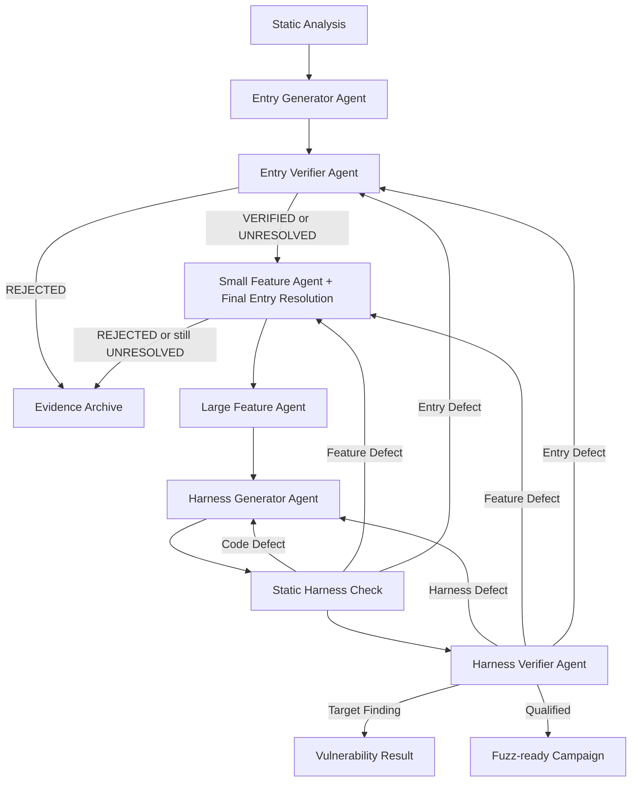

# HarnessCreator: 논리 구조 및 에이전트 동작 설계

## 1. 연구 목적

기존의 취약점 탐색 에이전트는 퍼징 하네스가 이미 존재한다는 가정 아래 동작하는 경우가 많다. 그러나 실제 버그 헌팅 환경에서는 분석 대상에 적절한 하네스가 존재하지 않거나, 존재하더라도 탐색하려는 기능과 상태를 충분히 반영하지 못할 수 있다.

HarnessCreator는 이러한 문제를 해결하기 위해 다음 과정을 자동화한다.

1. 프로그램 외부에서 입력이 유입되는 지점을 탐색한다.
2. 후보 지점의 실제 외부 입력 provenance를 검증한다.
3. 상호 의존적인 Entry와 상태 전이를 기능 단위로 복원한다.
4. 정상 프로그램 흐름을 보존하는 하네스를 생성한다.
5. 하네스 자체 결함과 실제 target 결함을 구분하며 검증한다.
6. 검증된 하네스와 분석 근거를 후속 취약점 탐색 에이전트에 전달한다.

본 시스템은 다음 여섯 에이전트로 구성된다.

1. Entry Generator Agent
2. Entry Verifier Agent
3. Small Feature Agent
4. Large Feature Agent
5. Harness Generator Agent
6. Harness Verifier Agent

정적 분석은 모든 에이전트가 공유하는 전처리 계층으로 사용한다.

## 1.1 추론 근거와 설계의 대응 관계

| 근거 | 핵심 개념 | HarnessCreator에서의 적용 |
|---|---|---|
| FuzzingBrain-V2 | 함수 단위 분석, caller/callee context 확장, Fuzz Introspector, Worker별 Direction과 seed/coverage 활용 | 공통 함수 메타데이터, Entry 검증 context, Large Feature와 후속 Worker 연계 |
| WINNIE | 정상 실행을 보존하는 효율적인 시작 지점, multi-call 부분 프로그램과 API lifecycle 복원 | Harness Anchor, Small Feature의 초기화·호출 순서·cleanup 구성 |
| *An Attack Surface Metric* | 프로그램과 외부 주체 사이에 형성되는 공격면 경계 | 정상 trace에 관찰된 함수가 아니라 외부 값이 프로그램으로 들어오는 경계를 Input Entry로 정의 |
| QuartetFuzz | P1/P2 하네스 품질 조건, P3 security boundary, P4 entry adequacy, adversarial 동적 검증 | 16개 생성·정적 검사, 경계/Entry 검사, seed replay와 crash attribution |

---

# 제1부. 에이전트 구조의 설계 추론 과정

## 2. 공통 정적 분석 구조의 설계 추론

### 2.1 문제 인식

소스 코드 전체를 한 번에 모델에 제공하면 중요한 함수와 호출 관계가 context에 묻힐 수 있다. 반대로 개별 함수만 제공하면 caller, callee, 초기화 및 상태 생성 경로가 누락되어 오탐이 증가한다.

### 2.2 함수 단위 Context 확장에 대한 추론

FuzzingBrain-V2는 함수를 기본 분석 단위로 사용하고, 필요한 경우 caller와 callee 방향으로 context를 확장한다. 이 방식은 전체 코드를 한 번에 처리하지 않으면서도 판단에 필요한 주변 정보를 단계적으로 확보할 수 있게 한다.

이에 HarnessCreator는 설치된 Fuzz Introspector의 build-free C/C++ frontend를 자동 실행해 report를 생성하고 이를 기준 자료로 함수의 정적 메타데이터를 만든다. 각 함수에 대해 최소한 다음 정보를 수집한다.

1. Caller 함수
2. Callee 함수
3. 함수 source code
4. 실제 declaration과 공개 header
5. 확인 가능한 build target

호출 구조는 재귀와 순환을 포함할 수 있으므로 실제 분석에서는 트리가 아닌 그래프로 관리한다. Context 확장 시에는 방문한 함수를 기록하고, 최대 depth와 최대 함수 수를 제한한다.

### 2.3 공통 분석 구조

```text
Project Source
  → Fuzz Introspector build-free frontend 자동 실행
  → project-wide JSON/YAML report 생성·cache
  → source·declaration·header·build metadata 보완
  → Function Metadata
  → Call Graph
  → 각 에이전트의 함수 단위 Context 확장
```

전통적인 C/C++ Fuzz Introspector LLVM/LTO 방식은 기존 fuzz target을 요구하지만, build-free frontend는 하네스 없이 프로젝트 source 전체를 분석할 수 있다. 따라서 기본 실행은 report를 외부에서 요구하지 않고 FI를 먼저 자동 수행한다. Source와 FI version digest가 같으면 cache report를 재사용한다. Report가 일부 함수만 포함하는 경우를 구분하기 위해 FI file/function record와 source index 함수의 대응률을 계산하며, 80% 미만인 결과는 strict 실행에서 거부한다. FI 실행 실패 시 source parser로 계속하려면 이를 명시적으로 선택해야 하며 결과를 비권위 분석으로 표시한다. 분석되지 않은 indirect call, function pointer, build conditional 등은 확정된 사실로 취급하지 않고 불확실성으로 유지한다.

### 2.4 Context 누적을 위한 Agent Session

함수 단위 확장은 함수 이름과 모델 요약만 다음 호출에 전달하는 방식이 아니다. 하나의 Candidate·seed Entry·Large Feature·Harness를 분석하는 동안 동일한 Codex app-server thread를 계속 사용한다. 따라서 함수 A를 읽고 B를 선택한 다음 B를 여는 turn은 A의 실제 source가 남아 있는 대화 context에서 수행되며, 이후 C를 열면 A+B+C의 source context가 누적된다. 후속 Small Feature turn은 새로 연 source만 추가하고 A·B 원문을 매번 다시 복사하지 않으며, 전체 열린 함수 목록은 source 없는 참조로 유지한다. 이 누적량이 model context window에 가까워지면 같은 thread를 app-server의 context compaction으로 압축하여 핵심 source 사실과 판단 상태를 보존한 채 계속한다. 압축은 최근 사용량 70% 또는 다음 turn 예상량 90%에서 선제 수행하며, 예측보다 먼저 window 초과가 발생해도 동일 thread를 한 번 압축하고 해당 turn만 재시도한다. 새 빈 thread로 바꿔 누적 추론을 잃는 복구는 허용하지 않는다.

병렬 worker를 사용할 때도 같은 논리적 Agent 작업은 최초 배정 worker에 고정한다. 서로 다른 Candidate 또는 Feature는 별도 thread로 격리하여 판정과 source가 섞이지 않게 한다. Worker 재시작 기준에 도달하더라도 active session이 있으면 해당 작업이 끝날 때까지 재시작을 미루며, 동적 검증 전에도 생성·검토·수정 session을 제거하지 않는다. Session은 해당 작업의 마지막 판정 또는 검증이 끝난 뒤에만 삭제한다.

---

## 3. Entry Generator Agent 설계 추론

### 3.1 실행 기반 입력 지점 탐색의 한계

WINNIE는 정상 입력을 실행한 뒤 실제 실행 흐름에서 효율적인 시작 지점을 추적한다. 이를 통해 프로그램의 최상위 함수부터 실행하는 비용을 줄이고, 정상 흐름을 유지하면서 target 기능에 접근할 수 있다.

그러나 정상 입력에서 실행되지 않은 기능은 분석 대상에서 제외될 수 있다. 따라서 정상 trace만을 기준으로 Entry를 탐색하면 지정되지 않은 정상 기능과 외부 입력 경계를 놓칠 수 있다.

### 3.2 Input Entry 정의

WINNIE의 정상 입력 trace만으로 Entry를 선택하면 해당 실행에서 관찰되지 않은 정상 흐름이 제외된다. 이를 피하기 위해 *An Attack Surface Metric*에서 다루는 프로그램과 외부 주체 사이의 경계라는 관점을 사용한다. 즉 특정 정상 입력의 실행 여부가 아니라, 프로그램 내부에서 결정된 값인지 프로그램과 구분되는 외부 주체 또는 인터페이스에서 들어온 값인지를 기준으로 Entry를 판단한다.

이에 Input Entry를 다음과 같이 정의한다.

> 프로그램 내부에서 정적으로 결정한 값이 아니라, 프로그램과 구분되는 외부 주체 또는 인터페이스가 소유한 값이 프로그램 소유 memory, argument 또는 state로 **최초 유입되는 지점 하나**를 Input Entry로 정의한다.

따라서 외부 입력의 영향을 받는 모든 함수가 Entry인 것은 아니다. 최초 획득 뒤의 parser, decoder, dispatcher, VM stack getter, object accessor 및 프로그램 내부 wrapper의 caller는 consumer 또는 실행 경로이지 새로운 Entry가 아니다.

외부 주체와 인터페이스에는 다음이 포함된다.

- 네트워크 peer
- 사용자 입력과 command line
- 파일, 데이터베이스 및 configuration store
- 환경 변수
- 다른 프로세스와 IPC/RPC peer
- OS 및 device
- plugin과 callback provider

Attack Surface의 전체 metric이나 damage-potential 점수를 계산하는 것이 목적은 아니다. 본 구조에서는 **프로그램과 외부 주체를 구분하고, 외부 값이 프로그램으로 들어오는 경계를 식별하는 관점**만 Input Entry 정의에 사용한다.

### 3.3 Generator와 Verifier의 분리

모든 함수에 대해 caller와 callee 의존성을 처음부터 정밀하게 분석하면 비용이 커진다. 또한 `read(fd, ...)`처럼 주변 context가 없으면 판단하기 어려운 후보를 너무 일찍 제거할 수 있다.

이에 Entry 탐색을 다음 두 단계로 분리한다.

1. Entry Generator Agent는 저비용·고처리량 모델인 `gpt-5.6-luna`를 사용해 외부 입력 가능성이 있는 후보를 폭넓게 수집한다.
2. Entry Verifier Agent는 최소 5.5급이라는 조건에 따라 `gpt-5.5`와 caller/callee context를 사용해 후보를 검증한다.

Entry Generator의 목적은 precision보다 recall을 확보하는 것이다. 따라서 다음과 같은 경우도 후보로 유지한다.

- 명확한 `recv()` 호출
- file 또는 configuration read
- `getenv()`와 argv 처리
- origin이 불명확한 fd에 대한 `read()`
- 외부 runtime이 payload를 직접 넘기는 callback일 가능성이 있고 등록 관계를 확인할 수 있는 함수
- IPC, RPC 또는 device input primitive의 실제 호출점

### 3.4 최종 역할

Entry Generator Agent는 `gpt-5.6-luna`로 제품 함수 메타데이터를 크기 제한 batch 단위로 분석하여 최초 외부 입력 후보를 생성한다. 긴 함수는 line-aware source excerpt로 전 구간을 나누므로 함수 뒤쪽의 유입 지점도 분석 범위에 포함된다. test/fuzz/benchmark 전용 함수는 LLM 호출 전에 제외하고, 모델 후보도 site 종류에 따른 정적 조건을 통과해야 한다. 이 단계의 결과는 확정된 Entry가 아니라 Entry Verifier가 검증할 후보 집합이다.

---

## 4. Entry Verifier Agent 설계 추론

### 4.1 후보 함수 단독 분석의 한계

Entry Generator가 수집한 후보 중 상당수는 함수 하나만으로 외부 입력 여부를 확정할 수 없다.

예를 들어 `read(fd, buffer, size)`가 존재하더라도 다음 정보가 필요하다.

- fd가 network socket에서 생성되었는가?
- regular file 또는 stdin에서 생성되었는가?
- 프로그램 내부 pipe에서 생성되었는가?
- 해당 buffer가 실제 parser 또는 dispatcher까지 전달되는가?

### 4.2 Context 확장 방식

FuzzingBrain-V2의 함수 단위 context 확장 방식을 Entry 검증에 적용한다. Candidate 함수 source 하나를 최초 context로 설정하고, 인접 caller와 callee는 source 없이 ID·이름·관계만 제시한다. 모델이 판단에 필요하다고 명시한 인접 함수만 다음 round에 열어 외부 source에서 Entry까지의 provenance를 추적한다.

```text
Candidate Function
  → Caller Context
  → Callee Context
  → Source API와 fd/object 생성 지점
  → 외부 값 전달 경로
  → Downstream Consumer
```

모델이 특정 함수의 추가 분석을 요구하면 현재 선택된 함수에 직접 연결된 정적 call graph 함수에 한해 context에 포함한다. 기존 source는 누적하며 round당 최대 3개, 전체 함수 수 및 round 수 budget을 초과하지 않는다. 요청이 없으면 자동 BFS나 depth 확장을 수행하지 않는다.

### 4.3 Entry 판정의 세 상태

정적 분석 정보가 부족한 후보를 모두 폐기하면 실제 Entry가 false negative로 제거될 수 있다. 따라서 Entry Verifier는 다음 세 상태를 사용한다.

- `VERIFIED`: 외부 source에서 Entry까지의 provenance가 확인됨
- `REJECTED`: 내부 상수 또는 프로그램 내부에서 생성된 값이라는 반대 근거가 확인됨
- `UNRESOLVED`: fd origin, callback 등록, indirect call 또는 build path 정보가 부족함

`UNRESOLVED`는 폐기하지 않고 이미 검사한 함수 ID와 함께 Small Feature Agent로 전달한다. Small Feature의 기능 의존성 탐색 중 Entry 판정을 계속하며, 마지막 round까지 확정하지 못하면 이후 context 확장 단계가 없으므로 DROP한다.
모델이 `VERIFIED`를 반환해도 유효한 source-to-entry path와 line evidence가 남아 있어야 하며, verifier confidence가 0.80 미만이면 확정 Entry로 사용하지 않고 `UNRESOLVED`로 내린다.

### 4.4 Entry 판정 구조

Input Entry는 **외부 데이터가 프로그램 내부의 data-bearing storage로 최초 유입되는 지점**만 의미한다. Entry Verifier는 이 정의에 대한 provenance만 판정하며 별도의 payload·상태·제어·설정 역할을 만들지 않는다.

- `recv`, `read`, `SSL_read`, file read, argv, 환경 문자열처럼 실제 데이터가 들어오는 지점은 Entry가 될 수 있다.
- `accept`, socket 생성, connect, readiness event, status/error 반환 및 resource handle 생성은 Entry가 아니라 실제 데이터 Entry에 도달하기 위한 선행 실행 context다.
- parser, dispatcher 및 decoder는 이미 유입된 데이터를 소비하므로 Entry가 아니다.
- 공격자 제어 가능성과 영향도는 Entry 존재 여부를 바꾸지 않으며 Large Feature 우선순위 근거로 사용한다.

따라서 `VERIFIED`와 `UNRESOLVED` Entry를 Small Feature Agent로 전달한다. `UNRESOLVED`는 기능 복원과 동시에 마지막으로 재판정하고, 승격된 Entry만 Feature 구성에 사용한다. 초기화, transport 및 lifecycle 구성 가능성은 Small Feature와 Harness 단계에서 복원한다.

### 4.5 Entry 관련 개념의 분리

Entry 분석 과정에서 다음 개념을 구분한다.

- **Input Source API**: `recv`, `read`, `getenv`처럼 외부 값을 가져오는 primitive
- **Entry Site**: 프로젝트 코드가 source API를 호출하거나 외부 callback 인자를 받는 위치
- **Entry Function**: Entry Site를 포함하는 프로젝트 함수
- **Downstream Consumer**: 입력을 처리하는 parser, decoder 또는 dispatcher
- **Harness Anchor**: 정상 경계를 보존하면서 하네스가 실제 코드 호출을 시작할 위치

Entry Function, Downstream Consumer 및 Harness Anchor는 동일할 수도 있지만 반드시 동일하지는 않다.

### 4.6 최종 역할

Entry Verifier Agent는 `gpt-5.5`로 후보별 caller/callee context를 확장하고 source-to-entry provenance를 검증한다. `VERIFIED`와 `UNRESOLVED` 및 이미 검사한 함수 집합을 Small Feature Agent에 전달하고, `REJECTED`만 이 단계에서 제외한다.

---

## 5. Small Feature Agent 설계 추론

### 5.1 Entry 단위 하네스의 한계

Entry 하나당 하네스 하나를 구성하면 여러 Entry와 상태 전이가 결합된 기능을 표현하기 어렵다.

예를 들어 다음 기능은 request Entry만 단독으로 호출해서는 정상적으로 수행되지 않는다.

```text
connect
  → handshake
  → authenticate
  → request
  → response
  → disconnect
```

### 5.2 부분 프로그램 복원을 통한 기능 단위 정의

WINNIE는 초기화, API 호출 순서, 반환값, points-to 관계 및 cleanup을 포함하는 부분 프로그램을 복원한다. 이 관점을 Entry 간 의존성과 정상 lifecycle 분석에 적용한다.

Small Feature는 다음과 같이 정의한다.

> 하나의 작업 요청이 필요한 전제 상태와 실제 프로그램 동작을 거쳐 성공, 실패 또는 안정된 상태 전이에 도달하는 최소 기능 단위이다.

### 5.3 Small Feature의 구성 요소

Small Feature는 다음 정보를 포함한다.

1. Entry 호출 전에 수행해야 하는 초기화
2. Entry 호출 전에 필요한 선행 상태
3. 기능 수행에 필요한 함수
4. Entry 및 함수 호출 순서
5. 성공과 실패를 판단하는 조건
6. 성공 경로와 실패 경로의 cleanup
7. 기능 수행 후 도달해야 하는 안정 상태
8. 기능에 대한 설명

### 5.4 Harness Anchor의 정의

프로그램 최상위 함수부터 하네스를 실행하면 target 도달 확률이 낮아진다. 반대로 core parser를 직접 호출하면 정상 validation, authentication 또는 dispatcher를 우회할 수 있다.

따라서 Small Feature Agent는 다음 조건을 만족하는 Harness Anchor를 선택한다.

- 실제 프로그램 함수임
- 외부 입력을 target consumer까지 전달함
- 정상 validation과 security boundary를 보존함
- 불필요한 process startup을 제외함
- 초기화와 cleanup을 재현할 수 있음

### 5.5 최종 역할

Small Feature Agent는 최소 5.5급이라는 조건에 따라 `gpt-5.5`로 검증된 Entry에서 caller/callee 및 상태 의존성을 확장하여 하나의 최소 기능을 복원한다. 여러 Entry가 기능 수행에 필요하면 root Entry와 supporting Entry로 함께 묶는다. 함수 예산은 다음에 열 후보를 관리하는 활성 작업창이며, 같은 agent session에서 앞서 읽은 함수 source는 작업창에서 밀려나도 누적 근거로 유지한다. 모델이 함수 ID 대신 함께 제시된 고유 함수 이름이나 `ID::이름` 표기를 사용해도 실제로 열린 함수 하나로 명확히 대응하면 같은 근거로 인정한다.

---

## 6. Large Feature Agent 설계 추론

### 6.1 Small Feature 단위 실행의 한계

FuzzingBrain-V2의 후속 취약점 탐색 구조에서 Small Feature마다 별도 하네스와 Worker를 생성하면 다음 문제가 발생한다.

- 하네스와 Worker 수가 증가한다.
- 동일한 초기화와 fixture가 반복된다.
- 하나의 Worker가 단일 기능만 포함하여 Direction 간 우선순위 비교가 제한된다.

### 6.2 Worker 효율성과 정상 흐름 보존

FuzzingBrain-V2의 Worker 및 Direction 구조를 효율적으로 사용하려면 서로 호환되는 Small Feature를 하나의 하네스에서 실행할 수 있어야 한다. 그러나 WINNIE의 정상 lifecycle 보존 원칙에 따라 실행 조건이 다른 기능을 자원 절약만을 목적으로 합쳐서는 안 된다.

이에 Large Feature의 1차 의미 정의를 다음과 같이 둔다.

> 정의한 Small Feature 중 첫 Entry가 같고 필요한 선행 상태가 같은 기능 집합이다.

첫 Entry가 같은 후보를 먼저 모은 뒤 `gpt-5.5`가 문장 표현이 다른 선행 상태의 의미적 동등성을 판정한다. 선행 상태에는 Entry 이전의 session, authentication, configuration, connection, object, mode만 포함한다. Opcode, command token, packet framing, byte/length 조건은 입력 구성 조건이며 Large Feature 분리 기준이 아니다. 요청별 결과와 cleanup도 각 selector branch에 남긴다. 같은 의미 집합이라도 공통 Harness Anchor, transport, build target 또는 isolation 정책이 충돌하면 하나의 실행 가능한 하네스로 만들 수 없으므로 실행 그룹에서는 분리한다. 이는 Large Feature의 의미 기준을 바꾸는 것이 아니라 잘못된 실행 결합을 막는 제약이다.

### 6.3 Large Feature의 호환 조건

Small Feature를 결합할 때 다음 조건을 비교한다.

- 첫 Entry 또는 호환 가능한 Harness Anchor
- 필요한 선행 상태
- input channel과 transport
- 배타적인 global configuration 또는 prerequisite state
- thread 또는 process isolation mode
- build target과 sanitizer 조건

첫 Entry와 실제 선행 상태가 같으면 하나의 의미 Large Feature로 묶는다. Anchor, channel, isolation, build target 충돌은 같은 의미 group을 여러 실행 group으로 나누는 제약일 뿐, command/opcode나 요청별 cleanup 차이는 분리 근거가 아니다.

### 6.4 입력 주체의 권한과 공격자 현실성

동일하게 실행 가능한 Large Feature라고 해도 보안상 탐색 가치는 같지 않다. 우선 공격자가 해당 입력 주체를 통제하기 쉬운지를 확인한다. 인증 없는 원격 주체, 일반 인증 사용자, 로컬 일반 사용자, 관리자 또는 특권 사용자, 신뢰 구성요소 통제 순으로 공격 조건이 어려워진다. 다음으로 입력이 일반 사용자 프로세스, 중요한 파일·데이터, 높은 권한 프로세스, 시스템 전체 중 어디까지 영향을 줄 수 있는지 판단한다. 공격자가 접근하기 쉬우면서 성공 시 영향이 큰 Large Feature를 먼저 탐색한다.

주체별 정상 capability 집합은 우선순위 점수에 섞지 않는다. 이는 현재 주체가 다른 모든 주체의 기능을 포함하는지 확인하여 비현실적인 전권 주체 하네스를 제외하기 위한 정책 근거로 사용한다.

반대로 어떤 입력 주체가 다른 모든 주체가 수행할 수 있는 정상 기능을 모두 포함하고, 실제 공격자가 그 주체를 통제하는 것도 구조적으로 비현실적이라면 해당 하네스의 탐색 효율은 낮다. 예를 들어 일반적인 client/server 신뢰 모델에서 보호 대상 client에 입력을 보내는 신뢰 server 자체를 공격자로 가정해야 하고, 그 server 주체가 이미 모든 client 주체의 기능을 수행할 수 있다면 하네스 생성 대상에서 제외한다.

이를 위해 Large Feature 그룹화 후 전체 Feature를 함께 보며 다음을 정의한다.

- Large Feature의 fuzz input을 실제로 통제하는 주체
- 주체가 입력을 통해 수행할 수 있는 프로그램의 정상 capability 집합
- 비교 가능한 다른 입력 주체와 capability 집합
- 공격자가 해당 주체를 점유하기 위한 최소 현실적 접근 조건
- Large Feature가 손상됐을 때 도달 가능한 최대 신뢰 가능한 영향 범위

취약점, 비정상 동작, 크래시, parser의 내부 단계나 helper 호출은 capability 수에 포함하지 않는다. 모델은 주체, capability, 접근 조건과 영향 범위를 판정하지만 우선순위 수치와 폐기 여부는 결정하지 않는다. 코드는 접근 용이도와 영향도를 곱한 `base_risk_score`를 그대로 `priority_score`로 사용한다. 접근 또는 영향 근거가 없으면 위험 점수 50을 사용한다. Capability 비교는 점수에 반영하지 않는다. 현재 주체가 다른 모든 주체의 capability를 포함하고 접근 조건이 `IMPLAUSIBLE`이며 confidence가 0.8 이상인 경우에만 Harness Generator 전달 대상에서 제외한다.

### 6.5 Worker와 기능 단위의 분리

Large Feature는 하네스가 공유할 수 있는 fixture의 단위이며, Small Feature는 해당 하네스 안의 variant 또는 campaign 단위가 된다. Scheduler는 resource 상황에 따라 여러 campaign을 하나의 Worker에 배치할 수 있다.

이를 통해 Small Feature를 억지로 합치지 않으면서도 Worker 수 증가를 제한한다.

### 6.6 최종 역할

Large Feature Agent는 `gpt-5.5`로 Small Feature 간 호환성을 검증하고, 하나의 하네스로 build하고 반복 실행할 수 있는 기능 집합을 구성한다. 이후 입력 주체의 정상 capability와 공격자 현실성을 전역 비교하여 하네스 생성 순서와 제외 대상을 확정한다.

---

## 7. Harness Generator Agent 설계 추론

### 7.1 LLM 기반 하네스 생성의 문제

LLM이 하네스를 직접 생성하면 다음과 같은 하네스 자체 결함이 발생할 수 있다.

- fuzz input을 사용하지 않고 상수를 전달함
- target parser 또는 protocol을 재구현함
- 필요한 초기화와 상태 전이를 생략함
- 실패 반환값을 무시하고 다음 함수를 호출함
- cleanup 누락, UAF 또는 stale state를 생성함
- 실제 코드에 존재하지 않는 함수를 호출함

### 7.2 하네스 품질 조건에 대한 추론

QuartetFuzz는 정상 하네스가 만족해야 하는 조건을 P1 Logic Correctness와 P2 API Protocol Compliance로 구분하고, 생성된 하네스를 정적·동적으로 검증한다.

이에 Harness Generator Agent는 Large Feature를 입력으로 받아 하네스 source뿐 아니라 실행 계약과 자체 검사 결과를 함께 생성한다.

### 7.3 하네스 구현 범위

하네스는 입력을 제한, 분할 및 전달하기 위한 최소 adapter와 orchestration만 구현한다.

하네스에서 수행할 수 있는 동작은 다음과 같다.

- input size 검사
- bounded field 분할
- 안전한 문자열 termination
- temporary file, pipe, loopback socket, argv 또는 environment 구성
- 실제 initialization/API/cleanup 호출
- 반환값 검사와 실패 경로 제어
- iteration 간 상태 reset 또는 isolation

다음 동작은 하네스에서 수행하지 않는다.

- parser 재구현
- protocol state machine 재작성
- command dispatcher 재작성
- authentication 또는 validation 우회
- 실제 프로그램 기능을 대체하는 로직 작성

### 7.4 Harness 생성 시 적용하는 16개 조건

Harness Generator Agent는 생성 과정에서 다음 조건을 모두 확인한다.

#### P1 — Logic Correctness

1. Resource leaks
2. Use-after-free
3. Stale state
4. Input flow
5. Buffer safety
6. Size checks
7. Undefined behaviour
8. No reimplementation

#### P2 — API Protocol Compliance

9. Startup / Init sequence
10. Input construction
11. State lifecycle
12. Result / Response handling
13. Cleanup sequence
14. Entry / Function existence
15. Action / State constraints
16. Prerequisite state

Generator의 self-check만으로 판정을 종료하지 않는다. 생성된 code, Feature 명세 및 정적 분석 결과를 대조하는 독립적인 정적 검사를 함께 수행한다.

### 7.5 최종 역할

Harness Generator Agent는 `gpt-5.5`로 Large Feature 하나를 기준으로 실제 프로그램 API를 호출하는 하네스를 생성한다. Source code, build/runtime manifest 및 16개 조건에 대한 self-audit를 함께 출력한다.

함수 분석은 Common Anchor 한 개에서 시작한다. 매 turn 현재 함수 source 하나만 읽고 필요한 다음 함수 후보를 뽑으며, 정적 caller/callee, 현재 source의 실제 함수 참조 또는 Feature가 이미 확정한 unopened required function 중 한 개만 다음 turn에 연다. 후보가 없으면 주변 함수를 자동으로 펼치지 않는다. 따라서 초기화 함수, callback 등록 함수, 입력 전달 함수 및 cleanup 함수는 모델이 필요성을 판단하고 순서대로 선택한 경우에만 최종 생성 context에 들어간다. 최종 심사에 source를 다시 제공할 때에는 짧은 함수의 미사용 예산을 긴 함수에 재분배하여 state-machine 후반부가 잘리지 않게 한다. 생성 코드가 직접 호출한 project 함수는 같은 session에서 현재 checkout source가 열려 있어야 하며 HC23이 이를 검사한다. Pinned canonical integration은 target 동작을 대신 증명하지 않지만, 현재 checkout에 대한 실제 build·runtime preflight 성공 여부와 build file의 정확한 compile-time 근거를 함께 기록한다. 이 검증을 통과한 compile-time 설정과 exported fixture 사용 방식만 build/lifecycle 근거로 사용할 수 있으며, file-scope static 접근은 금지하고 자체 index 범위를 검증한다.

초기화, 객체/context 생성, callback, reset 및 cleanup은 필수 슬롯이 아니다. 열린 source나 확정된 Feature에서 실제 의존성이 확인된 항목만 추적한다. 추가 lifecycle이 없는 직접 호출도 완전한 context가 될 수 있으며, 단순히 특정 종류의 함수가 발견되지 않았다는 사실은 미완성 근거가 아니다.

미완성 판정은 자유 형식 질문이나 `context_complete=false` 자체만으로 고정하지 않는다. 필수 의존성은 `blocking_dependency`로 표현하며, 이미 연 함수의 유효한 source line 또는 현재 Large Feature의 Small Feature ID를 근거로 가져야 한다. 아직 필수 blocker로 확정되지 않았더라도 `context_complete=false`와 정적으로 검증 가능한 다음 함수 후보가 함께 있으면 그 후보 한 개를 열어 탐색을 계속한다. 근거 있는 필수 의존성이 남았는데 다음 함수가 없거나 후보가 남은 채 안전 상한까지 도달한 경우에는 생성을 중단한다. 유효 후보 없이 근거 없는 선택 항목의 부재만 남은 경우에는 자동 graph 확장을 하지 않는다.

---

## 8. Harness Verifier Agent 설계 추론

### 8.1 정적 검증의 한계

16개 조건을 정적으로 확인하더라도 다음 문제는 실행을 통해서만 확인할 수 있다.

- 특정 size에서 발생하는 harness OOB
- 실패 경로의 cleanup 누락
- iteration 사이의 stale state
- 실제 target 함수에 도달하지 않는 input flow
- 모든 입력이 protocol 초기 단계에서 거부되는 문제

### 8.2 동적 검증 방식의 구성

QuartetFuzz의 adversarial harness validation을 적용하여 하네스 자체 결함을 유발할 수 있는 입력을 실행한다. 또한 FuzzingBrain-V2가 global fuzzing 전에 도달 가능한 초기 seed를 우선 확보하는 방식에 따라, 무작위 fuzzing 전에 최소 입력과 boundary input을 검증한다. FuzzingBrain-V2에서 사용한 다섯 개의 초기 seed 구성은 HarnessCreator에서 deterministic seed와 Feature 기반 adversarial seed를 함께 준비하는 근거가 된다.

### 8.3 Seed 구성

검증 seed는 다음 두 종류로 구성한다.

1. Empty, minimum size, boundary size, NUL, invalid selector 등을 포함하는 deterministic seed
2. Feature 구조와 정적 경고를 바탕으로 생성한 adversarial seed

모델이 생성한 seed는 raw byte 형식, 최대 길이 및 중복 여부를 검사한 후에만 사용한다.

### 8.4 Crash attribution

Crash가 발생했다고 하네스를 즉시 수정하면 실제 target 취약점을 제거할 수 있다. 따라서 crash를 먼저 다음과 같이 분류한다.

- `HARNESS_DEFECT`: adapter, lifecycle, cleanup 또는 상태 reset 문제
- `TARGET_FINDING`: 실제 target source에서 발생한 sanitizer violation
- `INFRA_ERROR`: build, timeout, debugger 또는 실행 환경 문제

Crash마다 sanitizer stack과 GDB backtrace를 함께 수집한다. 두 결과가 일치하면 귀속 근거를 강화하고, 하나만 판정 가능하면 그 근거를 사용하며, 서로 충돌하면 미귀속으로 처리한다.

### 8.5 Qualification fuzzing

모든 검증 seed를 통과한 하네스는 기본 300초 동안 fuzzing한다. 이 과정에서 다음을 확인한다.

- fuzz input이 실제 target까지 전달되는가?
- coverage가 시작 시점보다 증가하는가?
- Large Feature의 variant가 실행 가능한가?
- sanitizer에서 harness-only crash가 발생하지 않는가?
- timeout 또는 OOM이 허용 범위 안에 있는가?

Coverage는 300초 동안 계속 증가할 필요는 없으며, 시작 대비 실제 증가가 확인되어야 한다.

### 8.6 최종 역할

Harness Verifier Agent는 `gpt-5.5`의 추론과 결정론적 도구 실행을 결합해 build, seed replay, crash attribution 및 qualification fuzzing을 수행한다. 하네스 결함은 생성 단계로 반환하고, 실제 target crash는 취약점 결과로 보존한다.

---

# 제2부. 에이전트별 동작 명세

## 9. 공통 입력: 정적 분석 데이터

### 9.1 FunctionMetadata

```yaml
function_id: "fn-..."
name: "read_request"
qualified_name: "server::read_request"
signature: "int read_request(Session*)"
declaration: "int read_request(Session*);"
headers: ["include/server.h"]
file: "src/server.c"
start_line: 100
end_line: 150
source: "..."
callers: ["fn-..."]
callees: ["fn-..."]
external_calls: ["recv"]
build_targets: ["server"]
```

### 9.2 CallEdge

```yaml
edge_id: "edge-..."
caller_id: "fn-caller"
callee_id: "fn-callee"
line: 123
kind: "direct|indirect"
confidence: 1.0
```

### 9.3 사용할 수 있는 공통 분석 연산

- 함수 ID로 메타데이터 조회
- 특정 함수의 caller 조회
- 특정 함수의 callee 조회
- 선택된 함수 집합의 source 없는 직접 caller/callee frontier 조회
- 모델이 요청한 frontier 함수만 source context에 누적
- 선택한 함수 집합 내부의 call edge 조회
- 두 함수 사이의 call path 조회

---

## 10. Entry Generator Agent 동작 명세

### 10.1 입력

- 전체 `FunctionMetadata` 목록
- 함수 batch 크기
- 외부 입력 후보 생성 지침

### 10.2 분석 단위

기본 분석 단위는 함수 batch이다. Batch 내부에서는 각 함수와 함수 내부의 잠재적 source call site를 후보 단위로 분석한다.

### 10.3 수행 동작

1. test/fuzz/benchmark 경로와 non-product 전용 build target을 제외한 함수 목록을 설정된 크기의 batch로 나눈다.
2. 각 함수의 source, signature, file, external call 및 caller/callee ID를 제공한다.
3. 외부 값의 최초 획득점만 `DIRECT_ACQUISITION`, `PROCESS_START`, `EXPORTED_API`, `EXTERNAL_CALLBACK` 중 하나로 탐색한다.
4. `read(fd)`의 fd provenance처럼 의존성만 불명확한 실제 input primitive는 유지한다.
5. 알려진 source API에 대한 결정론적 후보를 함께 생성한다.
6. 모델 후보에 대해 실제 external call, process entry signature, 공개 declaration 또는 외부 payload callback 등록 evidence를 site 종류별로 검사한다.
7. parser/getter/dispatcher/output API, VM stack accessor, readiness/internal callback 및 프로그램 정의 wrapper caller를 제거한다.
8. 모델 후보와 결정론적 후보를 병합한다.
9. 동일 함수, source API 및 line의 후보를 중복 제거한다.
10. 실제 함수 범위를 벗어난 후보를 제거한다.

### 10.4 사용 구조체: EntryCandidate

```yaml
candidate_id: "entry-candidate-..."
function_id: "fn-..."
source_api: "read"
line: 144
site_kind: "DIRECT_ACQUISITION"
boundary_subject: "external fd/stream owner"
first_acquisition: true
channel_hint: "fd_or_stream"
rationale: "fd origin requires caller context"
confidence: 0.62
evidence:
  - kind: "source"
    function_id: "fn-..."
    file: "src/io.c"
    line: 144
    detail: "read imports bytes"
```

### 10.5 출력

중복 제거된 `EntryCandidate` 목록을 Entry Verifier Agent에 전달한다.

---

## 11. Entry Verifier Agent 동작 명세

### 11.1 입력

- `EntryCandidate` 하나
- 함수 call graph
- 최대 context round 수
- 최대 context 함수 수

### 11.2 분석 단위

분석 단위는 Candidate 하나와 모델이 명시적으로 선택한 caller/callee 함수의 누적 집합이다. 인접 함수 목록은 선택지일 뿐, source를 열기 전에는 evidence가 아니다.

### 11.3 Provenance 검증 동작

1. Candidate 함수를 최초 context로 설정한다.
2. 직접 caller/callee의 ID, 이름 및 연결 관계만 source 없이 제공한다.
3. Context 내부 함수 source와 선택된 함수 사이의 call edge를 분석한다.
4. Source API 또는 외부 callback에서 Candidate까지의 경로를 추적한다.
5. fd, object, buffer 및 payload의 생성·전달 관계를 확인한다.
6. 분석에 필요한 함수가 부족하면 현재 source 없는 인접 목록에 존재하는 함수 ID를 추가 요청한다.
7. 요청된 함수만 round당 최대 3개씩 기존 context에 누적한다. 요청이 없으면 자동으로 다른 함수를 열지 않는다.
8. Evidence의 function ID, file 및 line을 실제 context와 대조한다.
9. Context 밖의 evidence는 제거한다.
10. 외부 provenance와 별개로 Candidate가 그 값의 최초 획득점인지 확인한다.
11. `first_acquisition_confirmed`가 false인 `VERIFIED`를 허용하지 않는다.
12. Provenance path가 없는 `VERIFIED`는 `UNRESOLVED`로 처리한다.
13. 동일 function, 정규화된 source API 및 실제 evidence line을 가진 Entry Site만 병합한다.
14. 병합 전 record와 병합 근거를 별도 산출물로 보존한다.

### 11.4 사용 구조체: EntryRecord

```yaml
entry_id: "entry-..."
candidate_id: "entry-candidate-..."
status: "VERIFIED|REJECTED|UNRESOLVED"
entry_function_id: "fn-..."
entry_line: 144
source_api: "recv"
site_kind: "DIRECT_ACQUISITION"
boundary_subject: "network peer"
channel_kind: "network"
attacker_control: "full|partial|none|unknown"
provenance_path:
  - {function_id: "fn-accept", relation: "creates connected socket"}
  - {function_id: "fn-read", relation: "receives peer bytes"}
consumer_hints: ["fn-dispatch", "fn-parse"]
evidence: []
unknowns: []
verifier_confidence: 0.95
first_acquisition_confirmed: true
inspected_function_ids: ["fn-read", "fn-caller"]
verification_rounds: 3
rationale: "..."
```

### 11.5 Provenance 판정

#### VERIFIED

- 외부 source가 확인됨
- 외부 source에서 Entry까지의 전달 경로가 존재함
- Candidate가 외부 값의 최초 획득점임
- 실제 source 또는 call graph evidence가 존재함

#### REJECTED

- 내부 상수 또는 내부 생성 값이라는 근거가 존재함
- 주장된 외부 전달 경로가 존재하지 않음

#### UNRESOLVED

- fd origin 불명
- callback 등록 경로 누락
- indirect call 누락
- build conditional 또는 ownership 불명

### 11.6 출력

- `VERIFIED` Entry → Small Feature Agent에서 즉시 기능 구성에 사용
- `REJECTED` Candidate → 반대 근거와 함께 보존
- `UNRESOLVED` Candidate → 검사 이력과 함께 Small Feature Agent에서 최종 재판정

---

## 12. Small Feature Agent 동작 명세

### 12.1 입력

- `VERIFIED` 및 `UNRESOLVED` Entry 전체 목록
- 각 context 탐색을 시작할 seed Entry
- 함수 call graph

### 12.2 분석 단위

분석 단위는 seed Entry 주변의 caller/callee context에서 관찰되는 최소 transaction 후보들이다. Seed는 탐색 시작점이며 Small Feature의 root로 강제되지 않는다. 각 Entry context는 기능 후보를 0개, 1개 또는 여러 개 반환할 수 있다. 하나의 기능은 여러 Entry를 포함할 수 있고 하나의 Entry도 서로 다른 요청 또는 명령을 가진 여러 기능에 포함될 수 있으므로 Entry와 Small Feature는 다대다 관계이다. 같은 요청의 성공, 거부, 자원 실패 및 오류 처리는 서로 다른 Small Feature가 아니라 하나의 Small Feature 내부 outcome으로 묶는다.

### 12.3 수행 동작

1. `VERIFIED` 또는 `UNRESOLVED` Entry 하나를 context 탐색의 seed로 선택한다.
2. `VERIFIED`는 Seed Entry Function에서 시작한다. `UNRESOLVED`는 Entry Verifier의 `inspected_function_ids` 이력을 이어받되 새 함수 요청 공간을 남기고 아직 열지 않은 caller/callee를 source 없는 선택지로 제공한다.
3. 기능의 initialization, 선행 상태, 실제 action 순서, completion 또는 cleanup을 구분할 근거가 부족하면 `context_complete=false`와 현재 인접 선택지에서 필요한 함수 ID를 반환한다. 최종 Harness Anchor나 adapter 증명만 부족한 경우에는 기능을 삭제하거나 의미 탐색을 반복하지 않는다.
4. 요청한 함수 source만 round당 최대 3개씩 context에 추가해 다음 round를 수행한다. Context가 가득 차면 seed, 현재 Entry Function 및 현재 기능 필수 함수는 유지하고 오래된 비핵심 context를 교체하여 정확히 요청한 함수를 연다. 요청이 없으면 graph depth를 자동 확장하지 않는다.
5. 확장된 context에 함수가 포함되는 다른 Entry를 함께 수집한다. Frontier 함수에 다른 `UNRESOLVED` Entry가 있으면 그 ID를 표시한다.
6. Context에 포함된 모든 `UNRESOLVED`를 기능 분석과 동시에 `VERIFIED / REJECTED / UNRESOLVED`로 재판정한다.
7. Provenance가 Entry Function에 도달하고 line evidence, 최초 유입 확인 및 confidence 0.80 이상을 만족하면 `VERIFIED`로 승격한다.
8. 승격된 Entry가 현재 operation의 의존성이면 같은 Small Feature의 root 또는 supporting Entry로 포함한다.
9. 반대 근거가 확인된 Entry는 `REJECTED`로 DROP한다. 마지막 round까지 `UNRESOLVED`인 Entry도 DROP한다.
10. Context 안에서 seed와 관련된 최소 작업을 모두 열거한다.
11. 작업이 발견되지 않으면 기능 후보를 0개 반환한다.
12. 하나의 Entry에서 여러 dispatch 분기나 작업 결과가 확인되면 기능 후보를 여러 개 반환한다.
13. 각 기능 후보에서 최종 `VERIFIED` Entry만 root 또는 supporting으로 분류한다.
14. Entry 이전에 필요한 초기화와 선행 상태를 찾는다.
15. 기능 수행에 필요한 실제 함수를 찾는다.
16. Data, control, state 및 ownership dependency를 분석한다.
17. 실제 함수 호출 순서와 각 action의 선행 action ID를 구성한다.
18. 모든 root/supporting Entry를 최소 한 번 포함하는 `entry_call_order`를 실제 실행 순서대로 구성한다. 실제 lifecycle이 같은 Entry Site를 반복 호출하면 동일 Entry ID의 반복을 허용한다.
19. 반환값과 상태 코드를 기반으로 성공·실패 조건을 정의한다.
20. 성공 경로와 실패 경로의 cleanup을 각각 정의한다.
21. Completion oracle과 stable post-state를 정의한다.
22. 이후 하네스 계획에 사용할 Harness Anchor 후보와 근거를 기록한다. 확정할 수 없으면 기능은 유지하고 unresolved로 둔다.
23. Fuzz input과 실제 parameter 또는 transport 사이의 binding 후보를 기록한다. Process-start `argc/argv`처럼 최초 유입은 맞지만 실제 함수 본문이 parameter를 읽지 않으면 binding은 미증명으로 처리한다.
24. Anchor→Entry 경로와 Entry→Anchor 역방향 경로를 함께 확인한다. 정방향 edge 부재와 역방향 경계 우회는 모두 Harness planning blocker로 기록하되 의미 Feature는 보존한다.
25. Binding이 누락되면 검증된 Entry channel/source API로 transport requirement를 생성하고 exact adapter는 unresolved로 남긴다.
26. 모든 Entry에 대해 위 단계를 반복하며 기능 후보를 누적한다.
27. 후보 간 Entry, Anchor, required function 및 action overlap으로 비교 집합을 만든다.
28. 비교 집합 안에서 같은 요청 작업, Entry 순서, 선행 상태 및 lifecycle을 나타내는 후보를 병합한다. 낮은 helper까지만 연 부분 view와 event/state machine/parser 및 정상 caller까지 연 완성 view도 동일 작업이면 병합하고 가장 완전한 view를 기준으로 readiness를 판정한다. `UNRESOLVED` build target과 이후 확인된 실제 target은 별도 기능으로 분리하지 않는다. 같은 요청의 성공·거부·실패 분기는 하나의 기능 내부 outcome으로 합친다.
29. 같은 Entry를 공유하더라도 요청한 명령이나 작업 자체가 다르면 별도 Small Feature로 유지한다.
30. 모든 함수와 evidence가 제공된 context에 존재하는지 확인한다.

### 12.4 사용 구조체: SmallFeatureSpec

```yaml
small_feature_id: "sf-..."
name: "authenticated request"
description: "인증된 세션에서 하나의 요청을 처리한다."
root_entries: ["entry-request"]
supporting_entries: ["entry-handshake"]
entry_call_order: ["entry-handshake", "entry-request"]
harness_anchor: "fn-serve-request"
anchor_rationale: "session validation을 보존한다."
boundary_preserved: true
preconditions: ["session exists", "authenticated"]
initialization: ["initialize server context"]
required_functions: ["fn-init", "fn-serve", "fn-cleanup"]
actions:
  - action_id: "request"
    function_id: "fn-serve"
    consumes: ["fuzz_input"]
    produces: ["status"]
    allowed_after: []
    success_condition: "status == 0"
input_bindings:
  - source: "fuzz.data"
    destination: "socket peer bytes"
    transform: "bounded transport"
cleanup_success: []
cleanup_failure: []
stable_post_state: "session closed"
completion_oracle: "request handled or rejected"
evidence: []
unknowns: []
confidence: 0.9
channel_kind: "network"
build_target: "server"
isolation_mode: "in_process_reset"
input_binding_proven: true
entry_paths_complete: true
anchor_action_complete: true
action_order_complete: true
function_references_complete: true
entry_order_complete: true
planning_complete: true
planning_blockers: []
```

`preconditions`에는 첫 Entry 전에 필요한 프로그램 상태만 둔다. 요청 opcode, command token, packet framing 및 byte/length 조건은 `input_bindings.transform`과 action contract에 기록하며 Large Feature의 선행 상태로 사용하지 않는다.

### 12.5 출력

최종 `VERIFIED` Entry로 구성된 모든 의미 `SmallFeatureSpec`은 산출물로 보존한다. `planning_complete: true`인 목록만 Large Feature Agent에 전달한다. OSS-Fuzz backend에서는 Common Anchor 자체의 FI build-target 근거가 없거나 Small Feature build target과 일치하지 않는 별도 utility/example 기능, 그리고 현재 in-process libFuzzer가 보존할 수 없는 필수 fork/subprocess 기능도 harness-ready에서 제외한다. 기능의 의미 판정은 지우지 않고 blocker와 함께 남긴다. 최초 미확정 Entry의 승격 결과는 `entries/promoted-during-small.jsonl`, 최종 DROP 결과는 `entries/dropped-after-small.jsonl`, 최종 Entry 집합은 `entries/verified-final.jsonl`에 기록한다.

`isolation_mode`는 하네스 reset 편법이 아니라 실제 기능이 요구하는 실행 경계다. 열린 애플리케이션 source에서 작업 자체의 fork/exec/process 경계가 확인된 경우에만 `fork_per_input` 또는 `subprocess`를 사용하며, 전역 상태나 cleanup이 불명확하다는 이유만으로 선택하지 않는다.

다음 불변조건을 만족해야 한다.

- 하나의 Small Feature는 하나 이상의 Entry를 포함한다.
- 하나의 Entry는 서로 다른 여러 Small Feature에 포함될 수 있다.
- 하나의 Entry context는 기능 후보를 0개, 1개 또는 여러 개 생성할 수 있다.
- Seed Entry는 root로 강제되지 않으며 해당 context에서 생성한 각 후보의 root 또는 supporting으로 표현된다.
- 입력 Entry가 여러 개여도 하나의 lifecycle이면 Small Feature 하나로 병합한다.
- 같은 Entry를 공유해도 요청한 명령이나 작업이 다르면 서로 다른 Small Feature로 보존한다. 같은 요청의 성공·거부·실패 outcome만 다른 경우에는 하나로 묶는다.
- Entry Function에서 Harness Anchor로 내려가는 경로가 있으면 아래쪽 consumer로 판단하여 해당 Anchor의 하네스 사용을 차단하지만 의미 Feature는 보존한다.
- Partial graph에서 Harness Anchor→Entry 경로가 보이지 않는 경우에는 즉시 폐기하지 않고 unresolved path로 보존한다.
- Exact input adapter가 없으면 Entry 기반 transport requirement와 unknown을 보존하며, 이후 Harness planning에서 해결되기 전까지 qualified로 간주하지 않는다.
- `entry_call_order`는 모든 root/supporting Entry를 최소 한 번 포함하며 실제 호출 순서를 나타낸다. 실제 반복 호출은 같은 Entry ID의 반복으로 보존한다.
- Input binding, Anchor→Entry path, anchor action, action order, required/action 함수 참조 또는 Entry order가 미확정이면 의미 Feature로는 보존하되 하네스 생성 대상으로 사용하지 않는다.

---

## 13. Large Feature Agent 동작 명세

### 13.1 입력

- `SmallFeatureSpec` 목록

### 13.2 분석 단위

분석 단위는 공통 fixture와 execution policy를 공유할 수 있는 Small Feature 집합이다.

### 13.3 수행 동작

1. 각 Small Feature의 `entry_call_order` 첫 Entry를 확인한다.
2. 필요한 선행 상태를 정규화한다.
3. 첫 Entry가 같은 Small Feature를 후보로 모으고, 강한 모델이 선행 상태가 의미상 같은지 판정하여 그룹화한다.
4. 공통 Harness Anchor와 input channel/transport를 비교한다.
5. Isolation mode와 build target을 비교한다.
6. Opcode, framing, 길이와 같은 요청별 입력 조건을 선행 상태에서 분리한다.
7. 실제 선행 상태가 다르면 의미 group을 나누고, Anchor/channel/isolation/build target 실행 제약이 충돌하면 같은 의미 group 안에서 실행 group만 분리한다.
8. 여러 Small Feature를 포함하는 경우 selector 기반 variant를 정의한다.
9. 각 variant의 required functions와 evidence를 합친다.
10. 각 Small Feature의 `entry_call_order`로 반복 호출을 구분하는 Entry invocation node/edge를 구성하고, 실제 분석 graph의 member 함수 node/edge도 별도 필드로 함께 보존한다.
11. 전체 Large Feature를 대상으로 중복 없는 입력 주체 목록, 정상 capability 집합 및 공격 접근 조건을 구성한다.
12. 각 Large Feature를 실제 입력 통제 주체에 매핑하고 Feature별 영향 범위를 판정한다.
13. 접근 용이도×영향도에서 `priority_score`를 계산한다. Capability 비율은 순위에 반영하지 않는다.
14. 전권 capability를 가지면서 접근 조건이 `IMPLAUSIBLE`인 주체를 confidence 조건 아래 `DISCARD`하고, 나머지를 점수 내림차순으로 정렬한다.

### 13.4 사용 구조체: LargeFeatureSpec

```yaml
large_feature_id: "lf-..."
name: "server request operations"
description: "공통 session fixture를 사용하는 요청 기능 집합"
small_feature_ids: ["sf-a", "sf-b"]
small_feature_names: ["feature a", "feature b"]
common_anchor: "fn-serve"
common_initialization: []
common_cleanup: []
common_cleanup_failure: []
prerequisite_state: []
fixture_fingerprint: "..."
isolation_mode: "in_process_reset"
isolation_rationale: "..."
dispatch_strategy: "selector_byte"
variants:
  - {selector: "0", small_feature_id: "sf-a"}
  - {selector: "1", small_feature_id: "sf-b"}
entry_call_graph:
  nodes: [{id: "entry-invocation-...", entry_id: "entry-root", small_feature_id: "sf-a", position: 0, role: "root"}]
  edges: [{source_id: "entry-invocation-...", target_id: "entry-invocation-...", from_entry_id: "entry-root", to_entry_id: "entry-support", kind: "runtime_order"}]
  function_nodes: [{id: "fn-serve", name: "serve"}]
  function_edges: [{caller_id: "fn-serve", callee_id: "fn-dispatch", kind: "direct"}]
required_functions: []
security_priority:
  input_subject: "unauthenticated remote client"
  subject_capabilities: ["read public item"]
  comparison_subjects:
    - subject: "authenticated administrator"
      capabilities: ["read public item", "write item", "delete item"]
  capability_ratio: 0.3333
  capability_scarcity_score: 67
  attack_access: "UNAUTHENTICATED_REMOTE"
  access_score: 5
  impact_scope: "SENSITIVE_DATA"
  impact_score: 2
  base_risk_score: 50
  priority_score: 50
  attacker_feasibility: "HIGH"
  capability_superset_of_all_others: false
  disposition: "KEEP"
  rationale: "remote unauthenticated input is attacker-realistic"
  discard_reason: ""
  confidence: 0.95
evidence: []
```

### 13.5 강제 조건

- Worker 수를 줄이기 위한 목적으로 호환되지 않는 Feature를 병합하지 않는다.
- 공통 Anchor는 member Small Feature의 Anchor와 호환되어야 한다.
- 모든 Small Feature는 하나 이상의 Large Feature에 보존되어야 한다.
- 각 variant는 독립적으로 도달 가능한 입력을 가질 수 있어야 한다.
- 모델은 호환 group을 더 작게 분리할 수 있지만 이미 확인된 Anchor, 선행 상태, initialization, cleanup, isolation 및 required function을 새 값으로 교체할 수 없다.
- 하나의 Small Feature ID를 같은 grouping 결과의 여러 Large Feature에 중복 배치하지 않는다.
- 모델은 `priority_score`와 `disposition`을 직접 정하지 않는다. capability, 주체, 공격 접근 조건 및 영향 범위 판정만 수행하며 수치와 정책 적용은 코드가 담당한다.
- 다른 주체의 capability 근거가 없거나 Feature→subject 매핑이 누락되면 중립 점수로 `KEEP`한다.
- `DISCARD`된 Large Feature는 분석 artifact에는 보존하되 Harness Generator에는 전달하지 않는다.

### 13.6 출력

`KEEP`인 `LargeFeatureSpec`을 `priority_score` 내림차순으로 Harness Generator Agent에 전달한다. 전체 우선순위 및 제외 근거는 `features/large-priority.json`에 보존한다.

---

## 14. Harness Generator Agent 동작 명세

### 14.1 입력

- `LargeFeatureSpec` 하나
- Large Feature에 포함된 `SmallFeatureSpec` 목록
- Required Function의 `FunctionMetadata`
- 이전 검증 실패 정보
- 신뢰된 build configuration

### 14.2 분석 단위

분석 단위는 Large Feature 하나와 해당 Feature를 구현하는 실제 함수 집합이다. 출력 단위는 build 가능한 fuzz harness 하나이다.

### 14.3 수행 동작

1. Common Anchor 함수 source 하나만 연다. OSS-Fuzz backend이면 실제 검증과 같은 pinned revision의 canonical harness, build recipe 및 target options를 integration 참고 자료로 함께 제공한다.
2. 현재 함수와 Small Feature의 precondition, initialization, action 및 cleanup을 읽고 다음에 확인할 함수 후보를 우선순위순으로 뽑는다.
3. 정적 caller/callee, 현재 source의 실제 함수 참조 또는 Feature가 이미 확정한 unopened required function 중 최상위 후보 한 개만 열고, 충분한 근거가 모일 때까지 같은 절차를 반복한다. 자동 BFS는 수행하지 않는다.
4. 실제로 연 함수만 현재 checkout의 최종 생성 evidence로 사용한다. Canonical OSS-Fuzz 파일은 헤더·초기화·링크 구조 참고 자료일 뿐이며, 열지 않은 함수나 unrelated feature를 호출할 근거로 사용할 수 없다.
5. Fuzz input을 실제 parameter 또는 transport에 연결한다.
6. 최소 size와 최대 size를 정의한다.
7. 여러 variant가 존재하면 size guard가 있는 selector를 구성한다.
8. 실제 initialization과 API를 순서대로 호출한다.
9. 반환값을 확인하고 실패 시 후속 action을 중단한다.
10. 성공과 실패 경로의 cleanup을 구성한다.
11. Target logic을 재구현하지 않았는지 확인한다.
12. 정적 분석에서 발견된 header, declaration 및 build target만 사용한다.
13. 16개 조건에 대해 각각 정확히 하나의 `PASS`와 구체적 evidence를 self-audit으로 생성한다.
14. 정보가 부족하면 존재하지 않는 함수나 build target을 생성하지 않고 blocker를 반환한다.
15. 같은 Harness Generator Agent 안에서 생성 응답과 분리된 독립 검토를 한 차례 수행한다. 독립 검토는 생성기의 self-audit을 사실로 간주하지 않고 실제 함수 source, Feature lifecycle 및 HC01~HC16을 다시 대조한다.
16. 독립 검토의 `WARN` 또는 `FAIL`은 다음 생성 turn의 수정 feedback으로 사용한다. 이는 별도의 에이전트나 새로운 기능 분류가 아니라 QuartetFuzz의 검출·수정 절차를 Harness Generator 내부에 적용한 것이다.

### 14.4 사용 구조체: HarnessManifest

```yaml
harness_id: "harness-..."
large_feature_id: "lf-..."
source_file: "fuzzer_proxy.c"
build_target: "oss-fuzz:memcached/fuzzer_proxy"
engine: "libfuzzer"
sanitizers: ["address"]
execution_model: "in_process_reset"
headers: []
libraries: []
min_size: 1
max_size: 4096
dispatch_strategy: "selector_byte"
expected_anchors: ["fn-serve"]
expected_consumers: ["fn-parse"]
variant_count: 2
variant_targets:
  - {selector: "0", small_feature_id: "sf-a", function_id: "fn-action-a"}
  - {selector: "1", small_feature_id: "sf-b", function_id: "fn-action-b"}
verification_backend: "oss-fuzz"
backend_target: "memcached/fuzzer_proxy"
```

### 14.5 사용 구조체: HarnessDraft

```yaml
manifest: HarnessManifest
code: "생성된 fuzz harness source"
self_audit:
  - {check_id: "HC01", status: "PASS", evidence: "..."}
generation_blockers: []
```

### 14.6 독립 정적 검사

생성 결과에 대해 다음을 독립적으로 확인한다.

| ID | 검사 항목 | 확인 내용 |
|---|---|---|
| HC01 | Resource leaks | 성공·실패 경로의 allocation과 open 자원이 해제되는가? |
| HC02 | Use-after-free | 해제 후 동일 자원을 다시 사용하는가? |
| HC03 | Stale state | 다음 iteration 전에 상태가 reset 또는 격리되는가? |
| HC04 | Input flow | Fuzz input이 실제 target까지 전달되는가? |
| HC05 | Buffer safety | Harness 자체 OOB와 문자열 위반이 없는가? |
| HC06 | Size checks | Input field 접근 전에 길이를 확인하는가? |
| HC07 | Undefined behaviour | NULL, unaligned access, overflow 등 UB가 없는가? |
| HC08 | No reimplementation | 실제 Anchor를 호출하고 target logic을 재구현하지 않는가? |
| HC09 | Startup / Init sequence | 초기화 순서가 실제 프로그램과 일치하는가? |
| HC10 | Input construction | 입력 형식과 transport가 실제 계약과 맞는가? |
| HC11 | State lifecycle | 정상 상태 전이를 지키는가? |
| HC12 | Result / Response handling | 실패 반환값을 처리하는가? |
| HC13 | Cleanup sequence | 모든 경로에서 정상 cleanup을 수행하는가? |
| HC14 | Entry / Function existence | 모든 함수가 실제 코드에 존재하는가? |
| HC15 | Action / State constraints | 순서와 co-call 제약을 지키는가? |
| HC16 | Prerequisite state | 필요한 상태를 정상 동작으로 준비하는가? |

P3 Security Boundary Respect와 P4 Entry Adequacy는 Feature 및 Entry evidence와 함께 별도로 확인한다.

16개 self-audit 중 누락, 중복, `WARN`, `FAIL` 또는 빈 evidence가 하나라도 있으면 HC20으로 실패한다. 결정적 Static Gate의 `FAIL`은 즉시 수정하고, 정적 heuristic으로 확정하지 못한 `WARN`은 근거와 함께 독립 검토로 보낸다. 독립 검토에서는 모든 HC01~HC16이 `PASS`여야 build로 진행한다. 모델이 임의로 제안한 build target은 채택하지 않는다. Canonical OSS-Fuzz project/fuzzer integration 또는 trusted command/binary pair가 없으면 HC19 실패이며, `--no-dynamic-verification`도 실제 compiler/linker build gate는 생략하지 않는다. 실제 공개 caller가 graph상 Common Anchor에 도달하면 HC08의 정적 경계로 인정하되 최종 도달은 GDB로 확인한다. 현재 in-process libFuzzer backend에서 callback 내부의 일반 child/subprocess 실행은 coverage/crash 전달을 끊으므로 HC21 실패이고, 애플리케이션 구현 파일 직접 include는 project build 경계를 우회하므로 HC22 실패다. 빈 source는 생성된 하네스로 집계하지 않는다.

### 14.7 출력

정적 검사와 독립 검토를 모두 통과한 `HarnessDraft`를 Harness Verifier Agent에 전달한다. Code 자체 문제는 같은 Large Feature에서 재생성하고, 실제 함수 부재처럼 코드 수정으로 해결할 수 없는 lifecycle 또는 Entry 문제만 해당 이전 단계로 반환한다. 정적 검사만 통과하고 build·runtime 검증을 생략한 결과는 정상 하네스가 아니라 `DRAFT`이다.

---

## 15. Harness Verifier Agent 동작 명세

### 15.1 입력

- `HarnessDraft`
- 기본 canonical OSS-Fuzz project/fuzzer target 또는 command 호환 경로의 신뢰된 build command/binary path
- `LargeFeatureSpec`
- Static check 결과
- 기본 fuzzing 시간

### 15.2 분석 단위

| 분석 단위 | 설명 |
|---|---|
| Build | Harness 하나의 compile 및 link 결과 |
| Seed | 입력 하나에 대한 deterministic sanitizer replay |
| Crash | Sanitizer 또는 GDB stack 하나 |
| Campaign | Corpus와 시간 제한을 가진 fuzzing 실행 |

### 15.3 Seed 생성 및 검증

1. Empty, minimum, boundary 및 selector seed를 생성한다.
2. Feature와 Static warning을 기반으로 adversarial seed를 생성한다.
3. Seed 형식, 최대 길이 및 중복을 검사한다.
4. 기본 OSS-Fuzz 경로에서는 각 seed를 AP_Run_check 단일 sanitizer probe로 검사하고, fresh-corpus libFuzzer campaign의 동일 process 반복 iteration으로 stale state를 검사한다. Command 호환 경로에서는 같은 seed를 한 process에서 3회 반복한다.
5. 검증 중인 binary가 생성된 source의 `LLVMFuzzerTestOneInput` breakpoint에 도달하는지 먼저 확인하여, 다른 기존 fuzz target을 잘못 검증하는 경우를 차단한다.
6. 최소 5개 seed가 실제 application anchor에 도달하는지 GDB breakpoint로 확인한다.
7. 여러 Small Feature가 selector로 묶였으면 고정 smoke seed와 Harness Verifier가 만든 `variant-N-reach` 구조화 seed를 차례로 실행하고, 그중 하나 이상이 해당 Feature의 실제 action target에 도달하는지 확인한다.
8. Build와 deterministic replay는 통과했지만 도달 seed만 부족하면 Harness Generator로 즉시 되돌리지 않고, 실패 근거를 반영한 seed를 한 차례 추가 생성해 같은 하네스를 재검증한다.

### 15.4 Build 및 Replay 동작

1. 기본 경로는 LLM 실행 전에 QuartetFuzz import, pinned project recipe와 canonical source, Docker daemon 접근을 사전검사한다. FI 분석 뒤에는 pinned canonical harness를 사용자의 로컬 source overlay와 실제 project image로 기준선 build하고 빈 입력으로 실제 실행한다. build와 runtime probe가 모두 성공한 경우에만 Agent를 시작한다. 생성 검증 시에도 pinned OSS-Fuzz workspace에서 로컬 source checkout을 builder의 application source 위치에 덮어쓴 다음 canonical harness source를 생성 source로 교체하고 QuartetFuzz build를 실행한다. Command 호환 경로만 신뢰된 build command를 shell 없이 실행한다.
2. Compile, 실제 project object와의 link 및 timeout 결과를 기록한다.
3. 기본 OSS-Fuzz 경로는 address-sanitized binary를 사용한다. Command 경로는 생성 binary의 ASan·UBSan instrumentation 표식을 확인한다.
4. OSS-Fuzz 경로는 seed별 AP_Run_check를 수행하고 fresh-corpus campaign으로 반복 상태를 검사한다. Command 경로는 각 seed를 같은 process에서 3회 연속 실행한다.
5. OSS-Fuzz target의 canonical `.options`에 leak policy가 있으면 replay와 campaign에 같은 값을 적용한다.
6. Crash가 발생하면 sanitizer stack과 GDB backtrace를 모두 수집한다. Qualification campaign의 artifact directory도 host에 mount하여 입력을 잃지 않는다.
7. 두 attribution 결과가 충돌하면 `UNATTRIBUTED`로 처리한다.
8. 최소 5개 seed의 expected anchor 도달을 확인한다.
9. 모든 selector variant가 대응하는 Small Feature action target에 도달하는지 확인한다.
10. 하네스 또는 미귀속 crash를 만든 정확한 seed bytes를 regression corpus에 추가하고 다음 수정 attempt에서 다시 실행한다.
11. Target finding seed는 취약점 증거로 보존하되 qualification corpus에서는 제외하고, 나머지 corpus로 coverage fuzzing을 계속한다.

GDB는 OSS-Fuzz project image 안에서 실행한다. Image에 debugger가 없으면 검증 전용 Dockerfile layer에서 설치하며, debugger/Docker 실행 자체의 실패는 Entry·Feature·Harness 오류가 아닌 verification infrastructure failure로 분리한다.

### 15.5 Crash 판정

| 판정 | 조건 | 처리 |
|---|---|---|
| HARNESS_DEFECT | Generated harness source가 leading frame에 존재 | Harness Generator 또는 Feature 단계로 반환 |
| TARGET_FINDING | Target source가 sanitizer/GDB stack에 존재 | 취약점 결과로 보존 |
| INFRA_ERROR | Build 환경, timeout 또는 debugger 문제 | 동일 검증 단계 재시도 |
| UNATTRIBUTED | Harness와 target을 구분할 수 없음 | Qualified 처리하지 않고 추가 분석 |

Compiler runtime, sanitizer 및 application checkout 밖의 dependency frame은 건너뛴다. 현재 application source 경로 또는 정적 분석 파일과 일치하는 frame만 `TARGET_FINDING`의 근거가 되며, exact input bytes는 `findings/<id>/input`에 별도로 보존한다.

### 15.6 Qualification fuzzing 동작

1. deterministic seed 검증 후 비어 있는 fresh corpus로 campaign을 시작한다.
2. 기본 300초 동안 fuzzer를 실행한다.
3. 빈 입력 probe가 `cov:`를 출력하면 그 값을, 출력하지 않으면 campaign의 첫 `cov:`를 기준점으로 삼아 종료 `cov:`와 비교한다.
4. coverage sanitizer로 다시 빌드하고 llvm-cov per-file summary를 수집한다.
5. 지정한 application checkout 경로 아래에서 생성 harness를 제외한 실제 project 함수·라인 coverage가 0보다 큰지 확인한다.
6. Timeout, return code 및 sanitizer 결과를 확인한다.
7. 모든 조건을 통과하면 하네스를 qualified로 표시한다.
8. Target source로 귀속된 crash는 하네스 실패로 되돌리지 않고 finding으로 보존한다.

### 15.7 사용 구조체: SeedSpec

```yaml
name: "truncated-frame"
data_hex: "0001ff"
rationale: "length boundary를 검증한다."
check_ids: ["HC05", "HC06", "HC10"]
```

### 15.8 사용 구조체: VerificationResult

```yaml
qualified: true
build: {}
replays: []
fuzz: {}
harness_faults: []
target_findings: []
coverage_grew: true
reason: "qualification completed"
```

### 15.9 출력

- Qualified Harness
- Initial Corpus
- Build 및 Replay 결과
- Coverage 결과
- Harness defect 목록
- Target finding 목록

---

# 제3부. 전체 Workflow와 최종 산출물

## 16. 전체 Workflow



## 17. 단계 간 데이터 흐름

```text
Project Source
  ↓
FunctionMetadata + Call Graph
  ↓
EntryCandidate[]
  ↓
EntryRecord[]
  ↓
SmallFeatureSpec[]
  ↓
LargeFeatureSpec[]
  ↓
HarnessDraft + HarnessManifest
  ↓
Static Check Result
  ↓
SeedSpec[] + VerificationResult
  ↓
Fuzz-ready Campaign 또는 Target Finding
```

## 18. 후속 취약점 탐색 에이전트에 전달하는 단위

최종 산출물은 하네스 source 하나가 아니라 다음 정보를 포함하는 Campaign이다.

```text
FuzzCampaign =
  Verified Entry Records
  + Small/Large Feature Specifications
  + Harness Source and Manifest
  + Initial Corpus
  + Static and Dynamic Validation Results
  + Coverage Evidence
  + Isolation Policy
  + Known Unknowns
```

후속 FuzzingBrain-V2 기반 Worker는 Campaign 또는 Large Feature의 variant를 작업 단위로 사용한다. 각 Worker는 실제 coverage와 도달 가능한 함수에 기반하여 Direction을 생성하고 우선순위를 결정한다.

## 19. 논리적 불변식

1. Entry Candidate는 검증된 Entry가 아니다.
2. `VERIFIED`는 실제 외부 데이터가 해당 지점에서 최초 유입된다는 뜻이다.
3. 최초 `VERIFIED`와 Small Feature 단계에서 승격된 Entry만 Feature 구성에 사용한다.
4. `UNRESOLVED`는 Small Feature의 마지막 context round까지 재판정하며, 그때도 미확정이면 근거와 함께 DROP한다.
5. Small Feature는 함수 목록이 아니라 lifecycle을 가진 최소 transaction이다.
6. Harness Anchor는 Entry Function 및 Downstream Consumer와 구분한다.
7. Large Feature는 호환되지 않는 Small Feature를 자원 절약 목적으로 병합하지 않는다.
8. Harness는 target parser, protocol, dispatcher 및 상태 전이를 재구현하지 않는다.
9. Generator의 self-check와 독립 정적 검사를 모두 수행한다.
10. Crash는 attribution 이후에만 Harness defect 또는 Target finding으로 처리한다.
11. Target finding을 제거하기 위해 Harness를 수정하지 않는다.
12. Build 또는 동적 검증을 수행하지 않은 Harness는 qualified로 처리하지 않는다.
13. Fuzz Introspector를 기본적으로 자동 실행하며, 실행 실패 후 source fallback은 명시적으로 선택하고 권위 있는 call graph로 표시하지 않는다.
14. 생성 시도 수, 비어 있지 않은 source 수, 정적 통과 수 및 동적 qualified 수를 구분한다.
15. 유효 하네스가 하나도 없으면 성공이 아니라 `FAILED_NO_VALID_HARNESS`로 종료한다.
16. 의미 Small Feature가 있어도 harness planning 증명이 끝나지 않았으면 `FAILED_NO_HARNESSABLE_FEATURES`로 종료한다.

## 20. 참고 근거

- FuzzingBrain-V2: 함수 단위 context 확장, Fuzz Introspector 기반 분석, Worker/Direction 및 seed·coverage 활용
- WINNIE: 정상 실행 흐름을 보존하는 시작 지점과 multi-call harness 복원
- Pratyusa K. Manadhata and Jeannette M. Wing, *An Attack Surface Metric*: 프로그램과 외부 주체 사이의 공격면 경계를 구분하는 Input Entry 정의의 근거
- QuartetFuzz: P1 Logic Correctness, P2 API Protocol Compliance, P3 Security Boundary Respect, P4 Entry Point Adequacy 및 동적 harness 검증
