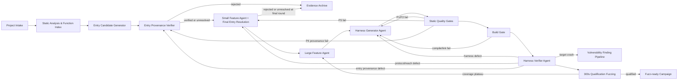
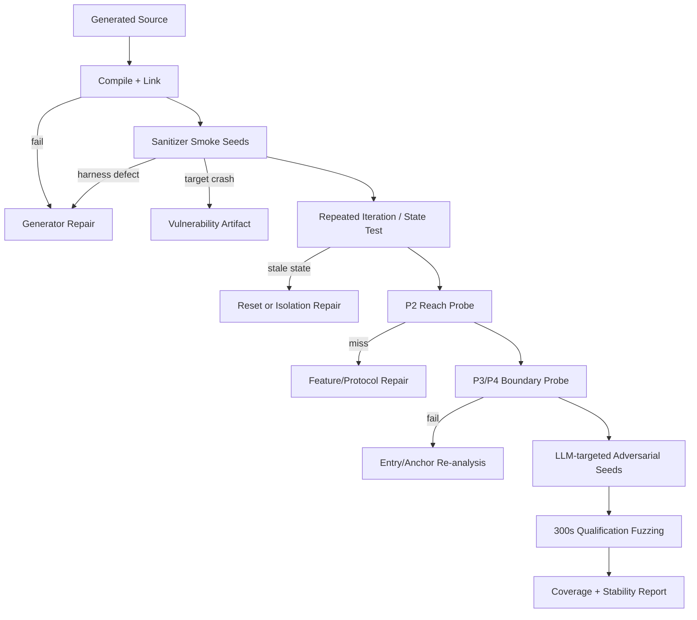

# HarnessCreator 설계

> 상태: 실행 가능한 MVP와 목표 아키텍처  
> 목표: 기존 하네스가 없는 실제 C/C++ 프로젝트에서 외부 입력 경계를 찾고, 정상 프로그램 흐름을 보존하는 퍼징 하네스를 생성·검증해 후속 취약점 탐색 에이전트에 전달한다.

## 1. 목표와 핵심 관점

HarnessCreator는 단순히 `LLVMFuzzerTestOneInput()` 코드를 작성하는 에이전트가 아니다. 이 시스템의 결과물은 다음 근거를 함께 가진 **검증된 fuzzing campaign**이어야 한다.

1. 어떤 외부 입력 경계에서 시작했는가.
2. 그 입력이 어떤 호출·데이터·상태 의존성을 거쳐 실제 기능으로 전달되는가.
3. 기능을 실행하기 전에 어떤 상태와 객체가 필요하고, 이후 무엇을 정리해야 하는가.
4. 하네스가 실제 애플리케이션의 검증·상태 전이·기능 코드를 우회하지 않는가.
5. 하네스 자체의 버그와 target의 버그를 어떻게 구분했는가.
6. 실제 fuzz input이 target까지 도달하고 coverage를 증가시키는가.

최상위 파이프라인은 다음과 같다.



중요한 원칙은 **각 단계가 자유 형식 설명을 넘기는 것이 아니라, versioned schema와 근거(evidence)를 넘긴다**는 것이다. LLM 판단은 실행 결과나 정적 분석 사실과 분리해 저장한다.

## 2. 연구에서 가져오는 요소

### 2.1 FuzzingBrain-V2에서 가져오는 것

- 함수 단위 분석
- 시작 함수 source를 기준으로 필요한 caller/callee만 모델이 선택해 context에 누적하는 방식
- Fuzz Introspector 기반 call graph와 함수 메타데이터
- 낮은 비용의 넓은 후보 생성과 높은 추론 능력의 검증 분리
- 후속 단계에서 사용할 coverage와 seed 생성

단, call graph는 트리가 아니라 순환·재귀·간접 호출을 포함하는 그래프다. 구현에서는 `visited set`, SCC 축약, 확장 budget, edge confidence가 필요하다.

### 2.2 WINNIE에서 가져오는 것

- 전체 프로그램 시작점보다 실제 입력 처리 기능에 가까운 효율적인 지점 선택
- 단일 API가 아니라 초기화, 호출 순서, 반환값, points-to 관계, cleanup으로 이루어진 부분 프로그램 복원
- 정상 흐름을 보존하지 않은 하네스가 false positive를 만든다는 관점
- 정상 입력 실행에만 의존하면 관찰하지 않은 기능이 누락된다는 한계

HarnessCreator는 정상 trace를 entry discovery의 유일한 근거로 사용하지 않는다. 대신 정적으로 외부 입력 경계를 넓게 찾고, 동적 실행은 후보 검증과 protocol 확인을 보조한다.

### 2.3 Attack Surface에서 가져오는 것

Attack Surface의 metric 전체를 가져오는 것이 아니라, 프로그램과 외부 주체 사이의 경계를 입력면으로 본다는 관점만 Entry 정의의 근거로 사용한다.

이 설계에서 입력 엔트리는 다음과 같이 정의한다.

> 프로그램 내부에서 생성된 상수가 아니라, 프로그램과 구분되는 환경 주체가 제어하거나 영향을 줄 수 있는 값이 프로그램의 메모리·인자·상태로 처음 유입되는 프로젝트 코드의 함수 또는 call site.

환경 주체에는 사용자, 다른 프로세스, 네트워크 peer, 파일·DB·레지스트리 같은 persistent store, OS/device, plugin, callback provider가 포함된다.

Attack Surface 논문의 전체 metric을 구현하는 것은 현재 범위가 아니다. 특히 exit point와 damage-potential/effort 점수는 후속 attack-surface prioritizer의 범위다.

### 2.4 QuartetFuzz에서 가져오는 것

- P1 Logic Correctness의 8개 검사
- P2 API Protocol Compliance의 8개 검사
- P3 Security Boundary Respect
- P4 Entry Point Adequacy
- 정적 self-review만으로 끝내지 않고 adversarial input, sanitizer, reach probe, coverage로 검증하는 방식
- 실패 결과를 generation 단계에 feedback하는 repair loop

본 설계의 16개 체크리스트는 P1 8개와 P2 8개다. P3/P4는 이 16개에 흡수하지 않고 **별도의 최종 gate**로 유지한다. Entry/Feature 단계에서 이미 확인했더라도 생성 과정에서 다시 위반될 수 있기 때문이다.

## 3. 용어를 먼저 분리한다

현재 아이디어에서 가장 중요한 보정은 “entry”, “target”, “harness anchor”를 같은 것으로 취급하지 않는 것이다.

### 3.1 Input Source API

외부 값을 실제로 가져오는 OS·runtime·library primitive다.

- `recv`, `recvfrom`, `read`, `fread`
- `getenv`, `GetEnvironmentVariable`
- `main(argc, argv)`, stdin
- RPC/IPC receive, message queue dequeue
- shared-memory read
- callback 인자
- DB/file/config read

### 3.2 Entry Site

외부 주체가 제공한 데이터가 프로그램 소유 buffer, string, argument, object field 등 data-bearing storage로 **최초 유입되는 한 지점**이다. 프로젝트 코드의 source API call site, `main`의 argv/envp 수신점, 증명된 공개 API의 함수 진입점 또는 외부 runtime이 데이터를 넘기는 callback 진입점이 이에 해당한다. 예를 들어 프로젝트의 `read_request()` 내부 `recv()` call site가 Entry Site다. `accept`, socket 생성, connection 설정 및 readiness event는 실제 데이터를 받는 Entry가 아니라 그 Entry에 도달하기 위한 선행 실행 context다.

### 3.3 Entry Function

entry site를 포함하거나 외부 주체가 직접 호출하면서 외부 값을 인자로 받는 프로젝트 함수다. `read()` 자체처럼 프로젝트 밖 심볼은 entry function ID가 아니라 source API evidence로 기록한다.

### 3.4 Downstream Consumer

entry에서 유입된 값을 전달받는 parser, dispatcher, decoder 등이다. 외부 값에 영향을 받는다는 이유만으로 모두 entry라고 부르지 않는다.

### 3.5 Harness Anchor

하네스가 실제 애플리케이션 코드를 호출하기 시작하는 지점이다. entry와 같을 수도 있지만 반드시 같지는 않다.

예를 들어 다음 흐름을 생각한다.

```text
main → server_init → accept → authenticate → recv → dispatch → parse
```

- `recv`가 있는 함수는 input entry다.
- `parse`는 downstream target이다.
- `parse`를 직접 부르면 인증·dispatch 검사를 우회할 수 있다.
- `main`부터 실행하면 느리고 제어하기 어렵다.
- 적절한 harness anchor는 정상 session을 만든 뒤 `serve_authenticated_request`일 수 있다.

따라서 Small Feature Agent는 entry를 묶는 것뿐 아니라 **정상 경계를 보존하면서 가장 짧은 실행을 제공하는 anchor**를 선택해야 한다.

### 3.6 Small Feature

기존 정의를 다음처럼 확장한다.

> 하나의 외부 요청 또는 event를 받아, 필요한 전제 상태에서 실제 애플리케이션 동작을 수행하고, 관찰 가능한 성공·실패·상태 전이를 만든 뒤 정상 종료 또는 다음 안정 상태에 도달하는 최소 transaction slice.

단순 함수 목록이 아니라 다음 형태다.

```text
precondition → initialization → input acquisition/construction
             → ordered/guarded actions → observable outcome → cleanup
```

streaming, callback, background task처럼 한 번의 성공/실패로 끝나지 않는 기능은 `completion_oracle` 또는 `stable_post_state`로 경계를 정한다.

### 3.7 Large Feature

큰 기능은 하네스 하나로 안전하게 공유할 수 있는 **공통 fixture와 isolation 정책**을 가진 Small Feature 집합이다.

초기 제안인 “첫 entry가 같고 선행 상태가 같다”는 필수 신호지만 충분조건은 아니다. 최종 compatibility key는 다음을 포함한다.

- harness anchor 또는 호환 가능한 public API family
- 공통 initialization/cleanup fixture
- prerequisite state fingerprint
- input transport/file/network/memory 방식
- object ownership와 lifecycle
- thread/process isolation mode
- 서로 양립 가능한 global configuration
- sanitizer/build target

Large Feature가 만들어지면 해당 입력을 실제로 통제하는 주체를 식별한다. 프로그램이 의도한 정상 기능만을 기준으로 주체별 capability 집합을 구성하며, 취약점·크래시·parser 내부 단계·helper 함수는 capability로 세지 않는다. 하네스 우선순위는 공격자가 그 주체를 통제하기 쉬운 정도와 성공 시 영향을 줄 수 있는 자산·권한 범위만으로 정한다. Capability 비교는 우선순위가 아니라 제외 정책에 사용한다. 현재 주체의 capability가 다른 모든 주체의 capability를 포함하면서 공격자가 그 주체를 차지하는 것이 구조적으로 비현실적이면 분석 결과만 보존하고 하네스 생성 대상에서는 제외한다.

## 4. 정적 분석 계층

### 4.1 Fuzz Introspector 기준 분석과 bootstrap 경계

HarnessCreator의 목표는 기존 하네스가 없는 프로젝트다. 전통적인 C/C++ Fuzz Introspector LLVM/LTO 방식은 기존 fuzz target을 요구해 순환이 생기지만, FI 0.1.10에는 build 없이 source 전체를 분석하는 C/C++ frontend가 존재한다. HarnessCreator는 이 frontend를 하네스 생성 전에 자동 실행한다. 단순 bootstrap parser의 caller/callee 결과를 Fuzz Introspector 결과처럼 취급하면 잘못된 Context가 전체 Workflow로 전파되므로 두 provider는 명확히 구분한다.

기본 `run`은 명시적 report가 없으면 Fuzz Introspector build-free frontend를 subprocess로 실행해 프로젝트 전체 module report를 생성한다. source content와 FI version의 digest별로 cache하며 `runs`, `runs-*`, build/output 및 현재 run output은 입력에서 제외한다. FI가 함수처럼 모델링한 function-like macro는 Entry/Feature root에서 제외한다. FI file/function record가 source index 함수의 80% 미만이면 부분 report로 판정하여 strict 실행을 중단한다. `--fuzz-introspector`는 사용자가 준비한 다른 FI report로 자동 결과를 override한다. `--allow-source-analysis`는 FI 실행을 생략하지 않고, FI 실행 자체가 실패한 경우에만 bootstrap fallback을 허용한다. fallback 결과는 `authoritative: false`로 기록한다. source indexer는 header declaration, Makefile.am, CMake 및 compile database의 build metadata를 보완한다.

FI report의 절대경로가 container/build host와 현재 checkout 사이에서 달라지면 source root 안의 고유한 최장 path suffix로 재매핑한다. 현재 run의 output root가 source tree 내부에 있으면 해당 경로는 source와 build metadata 탐색에서 제외해 이전 생성 하네스가 다음 분석을 오염시키지 못하게 한다.

정적 분석 계층의 확장 순서는 다음과 같다.

1. `compile_commands.json`과 Clang AST/LLVM 기반 function index
2. Fuzz Introspector가 생성한 프로젝트 함수·호출 정보
3. Joern/SVF 같은 call/data-flow provider(선택)
4. 명시적으로 선택한 bootstrap source indexer
5. build system에서 얻은 target/link/include 정보

현재 구현은 자동 생성되거나 명시적으로 지정된 Fuzz Introspector report를 기준으로 source indexer의 source·declaration·header·build target 정보를 병합한다. provider 결과가 충돌하면 하나를 덮어쓰지 않고 edge별 provenance와 confidence를 보존한다.

### 4.2 FunctionMetadata

사용자가 제시한 `caller`, `callee`, `source`는 필수지만 구현에는 다음 필드가 더 필요하다.

```yaml
schema_version: 1
function_id: "sha256(language|module|mangled_name|file|start_line)"
name: "parse_request"
qualified_name: "server::Session::parse_request"
mangled_name: "_ZN6server7Session13parse_requestEPKhm"
language: "cpp"
signature:
  return_type: "Status"
  parameters:
    - {name: "data", type: "const uint8_t *"}
    - {name: "size", type: "size_t"}
declaration: "Status parse_request(const uint8_t *data, size_t size);"
headers: ["include/server/session.h"]
source:
  file: "src/session.cc"
  start_line: 120
  end_line: 196
  text_ref: "blob://..."
module: "libserver"
build_targets: ["server_core"]
visibility: "public|internal|static|exported|unknown"
callers:
  - edge_id: "..."
    function_id: "..."
    callsite: {file: "src/worker.cc", line: 88}
    kind: "direct|virtual|function_pointer|callback|unknown"
    confidence: 0.92
    providers: ["llvm", "joern"]
callees: []
external_calls: ["recv", "malloc"]
globals_read: ["g_config"]
globals_written: ["g_session_count"]
complexity:
  cyclomatic: 14
  basic_blocks: 38
analysis_completeness:
  source: true
  callers: "partial"
  callees: "partial"
```

이 ID 체계가 필요한 이유는 overload, 같은 이름의 static 함수, template instantiation, macro-generated function을 구분하기 위해서다.

### 4.3 GraphStore

호출 관계는 트리가 아니라 directed multigraph로 저장한다.

- 동일 함수 사이 여러 call site 허용
- direct/indirect/callback edge 구분
- recursive SCC를 하나의 요약 노드로 축약 가능
- caller와 callee 양방향 조회
- call path query
- source API까지 backward path query
- target consumer까지 forward path query
- 최대 depth보다 token/edge budget을 우선 사용

## 5. Entry Candidate Generator

### 5.1 책임

제품 실행 경로의 FunctionMetadata를 저비용 모델로 독립 분석하여 최초 획득점 recall을 높인다. 이 단계에서는 fd provenance나 전체 초기화 의존성을 증명하지 않지만, 이미 획득된 값의 소비 지점을 후보로 확장하지 않는다.

### 5.2 입력

- 한 함수의 FunctionMetadata
- 외부 입력 source API catalog
- 언어별 entry pattern catalog
- 프로젝트의 제외 경로(vendor/test/generated)

### 5.3 출력

```yaml
candidate_id: "entry-candidate-..."
function_id: "..."
source_api: "recv"
line: 144
site_kind: "DIRECT_ACQUISITION|PROCESS_START|EXPORTED_API|EXTERNAL_CALLBACK"
boundary_subject: "network peer"
first_acquisition: true
channel_hint: "network"
rationale: "recv writes peer-owned bytes into request_buf; fd origin requires context"
confidence: 0.43
evidence:
  - {kind: "source", function_id: "...", file: "src/net.c", line: 144, detail: "recv call"}
```

### 5.4 동작 규칙

- `read(fd, ...)`에서 fd가 불명확해도 후보로 남긴다.
- 외부 primitive를 감싼 wrapper에서는 wrapper 내부의 실제 외부 획득 call site만 남기며, 그 wrapper를 부른 caller를 별도 Entry로 만들지 않는다.
- callback parameter는 외부 runtime의 payload callback 등록 관계가 정적으로 확인된 경우에만 후보로 남긴다. 내부 function pointer, readiness callback 및 VM stack getter는 제외한다.
- downstream parser는 entry가 아니라 `possible_consumer`로 별도 태깅한다.
- test/fuzz/benchmark 경로와 non-product 전용 build target은 LLM 호출 전에 제외한다.
- LLM 결과와 별도로 deterministic signature scan을 함께 수행한다.
- 같은 call site를 중복 제안한 후보는 deterministic dedup한다.
- 이 단계의 confidence는 reject에 사용하지 않는다.

### 5.5 병렬화

함수 단위 map task로 실행한다. 작은 함수 여러 개를 token budget 내에서 batch할 수 있지만 각 결과에는 반드시 function ID가 있어야 한다.

## 6. Entry Provenance Verifier

### 6.1 책임

후보가 실제 외부 입력 경계인지 증명한다. 단순히 주변 코드를 읽는 것이 아니라 handle/data provenance와 호출 가능성을 확인한다.

### 6.2 Context 확장 알고리즘

```python
selected = [candidate.function_id]

for round in range(max_rounds):
    context = source_of(selected)
    choices = direct_caller_callee_refs(selected)  # ID/name/relation only; no source
    decision = verifier(context, choices)

    if decision.context_complete:
        return decision.verdict

    requested = decision.requested_function_ids & choices.ids
    requested = requested[:3]
    if not requested or len(selected) >= function_budget:
        return UNRESOLVED

    selected.extend(requested)  # only requested source is opened next round

return UNRESOLVED
```

자동 BFS나 caller 우선 depth 확장은 수행하지 않는다. 첫 라운드에는 Candidate source 하나만 제공한다. 이후 라운드에는 이미 선택된 source를 유지하면서 모델이 source 없는 인접 목록에서 명시적으로 고른 함수만 최대 3개 추가한다. 따라서 로그의 함수 이동도 실제로 새 source를 연 선택만 나타낸다. 모델은 다음 근거를 해결하는 데 필요한 인접 함수를 선택한다.

- `fd/socket/FILE*/handle`을 생성하거나 할당하는 caller/callee
- callback 등록 함수
- exported/public API 또는 process entry
- 입력 buffer의 producer
- prerequisite global/object의 initializer
- indirect edge confidence

### 6.3 3상태 verdict

`OK 아니면 폐기`는 정적 분석 누락을 false negative로 바꾼다. 다음 세 상태를 사용한다.

- `VERIFIED`: 외부 origin과 entry site에 대한 충분한 근거가 있음
- `REJECTED`: 값이 내부 상수이거나 program-external origin이 아니라는 반대 근거가 증명됨
- `UNRESOLVED`: indirect call, build 누락, fd provenance 불명 등으로 판단 불가

`UNRESOLVED`는 즉시 버리지 않고 이미 검사한 함수 ID와 함께 Small Feature Agent로 보낸다. Small Feature가 기능 의존성을 확장하는 동안 Entry 판정도 계속하며, 이 단계의 마지막 round까지 확정하지 못하면 이후에는 context 확장 단계가 없으므로 DROP한다.

여기서 `VERIFIED`는 **실제 외부 데이터가 Candidate 지점에서 최초 유입된다는 provenance가 증명되었다**는 뜻이다. 연결 생성, readiness, status/error, resource handle처럼 데이터 유입이 아닌 사건은 `VERIFIED` Entry가 될 수 없다. 공격자 제어 수준은 Entry 여부를 바꾸지 않고 Large Feature 우선순위 판단에 사용한다.

### 6.4 EntryRecord

```yaml
entry_id: "entry-..."
candidate_id: "entry-candidate-..."
status: "VERIFIED"
entry_function_id: "..."
entry_line: 144
source_api: "recv"
site_kind: "DIRECT_ACQUISITION"
boundary_subject: "network peer"
channel:
  kind: "network"
  endpoint: "connected_socket"
  authentication_required: "unknown"
data:
  carrier: "buffer"
  attacker_control: "full|partial|none|unknown"
  length_source: "recv return value"
provenance_path:
  - {function_id: "accept_loop", relation: "creates_socket"}
  - {function_id: "serve_client", relation: "passes_fd"}
  - {function_id: "read_request", relation: "receives_bytes"}
consumer_hints: ["dispatch_request", "parse_header"]
evidence:
  - {kind: "source", file: "src/net.c", lines: [140, 151]}
  - {kind: "call_edge", edge_id: "..."}
unknowns: ["TLS layer may wrap recv in alternate build"]
verifier_confidence: 0.91
first_acquisition_confirmed: true
```

`VERIFIED`와 `REJECTED`는 모델이 직접 제시한 유효한 line-level evidence를 요구한다. 또한 `VERIFIED`에는 `first_acquisition_confirmed: true`가 필요하다. 외부 provenance는 있지만 이미 획득된 값을 읽거나 전달하는 지점이면 Entry가 아니다. Evidence가 실제 함수 file/line과 맞지 않아 Entry Generator의 후보 근거만 남으면 `UNRESOLVED`로 강등한다. Provenance path가 Candidate Entry Function에 도달하지 않는 `VERIFIED`도 같은 방식으로 강등한다.

### 6.5 Entry의 전달

별도의 input-role 또는 eligibility 분류를 두지 않는다. `VERIFIED` Entry와 아직 근거가 부족한 `UNRESOLVED` Entry를 Small Feature Agent로 전달한다. `UNRESOLVED`에는 `inspected_function_ids`와 `verification_rounds`를 기록하여 같은 source 탐색을 처음부터 반복하지 않는다. `REJECTED`는 반대 근거와 함께 보존하지만 전달하지 않는다.

- `accept`, socket 생성, readiness callback 등은 Entry 후보 단계에서 제거하고 Small Feature의 초기화·선행 상태 context로만 사용한다.
- 환경 변수, argv, 파일, network, IPC/RPC 및 device를 통해 실제 데이터가 들어오는 지점은 동일한 Entry 정의로 다룬다.
- 공격자 제어 가능성이나 영향도는 Entry를 제거하는 조건이 아니라 Large Feature의 우선순위 근거다.
- transport, adapter, 초기화 및 cleanup의 구체화는 Small Feature와 Harness 단계의 책임이다.

## 7. Small Feature Agent

### 7.1 책임

모든 `VERIFIED` 및 `UNRESOLVED` entry에서 caller/callee와 data/state dependency를 확장해 최소 transaction slice를 복원한다. 동시에 `UNRESOLVED`의 외부 데이터 최초 유입 여부를 재판정한다. 여러 entry가 하나의 기능에 필요하면 하나의 Small Feature로 묶되 최종적으로 `VERIFIED`된 Entry만 구성원이 될 수 있다.

Small Feature의 생성 횟수는 Entry 수로 결정하지 않는다. 모든 Entry를 각각 context 탐색의 seed로 사용하되, 한 context에서 Small Feature 후보를 0개, 1개 또는 여러 개 복원할 수 있다. 하나의 기능 후보가 여러 Entry를 `root_entries`와 `supporting_entries`로 포함할 수 있고, 반대로 하나의 Entry도 dispatch 결과나 요청 종류에 따라 여러 Small Feature에 반복해서 포함될 수 있다. 따라서 Entry와 Small Feature의 관계는 일대일이나 소유 관계가 아니라 다대다 관계이다.

seed Entry는 context 탐색을 시작하기 위한 위치일 뿐, 최상위 입력을 의미하지 않는다. 각 context에서 반환되는 기능 후보에는 seed가 root 또는 supporting으로 포함되어야 하지만 이를 root로 강제하지 않는다. 다른 Entry의 context에서도 같은 기능을 다시 관찰할 수 있으므로 먼저 모든 Entry별 기능 후보를 보존한 뒤, Entry 공유 여부가 아니라 요청 작업, `entry_call_order`, 선행 상태 및 lifecycle이 같은 후보를 하나의 Small Feature로 병합한다. 낮은 read helper에서 끝난 후보와 이후 round에서 event/state machine/parser 및 정상 caller까지 확장된 후보는 서로 다른 기능이 아니라 동일 기능의 부분·완성 view로 병합하고 가장 완전한 view의 readiness를 사용한다. 이때 `UNRESOLVED` build target은 별도 기능을 뜻하지 않으며 이후 확인된 실제 target에 흡수된다. 같은 Entry를 공유하더라도 요청한 명령이나 작업 자체가 다르면 별도 Small Feature로 유지한다. 반대로 같은 요청의 성공·거부·자원 실패·오류 처리는 Small Feature를 분리하는 기준이 아니며, action guard와 completion oracle 및 성공/실패 cleanup으로 한 기능 안에 표현한다.

탐색은 단일 snapshot/단일 LLM 호출로 끝내지 않는다. `VERIFIED` seed는 기존 방식대로 시작하고, `UNRESOLVED` seed는 Entry Verifier가 열었던 source 이력을 이어받되 새 함수 요청을 위한 context 자리를 항상 남긴 상태에서 아직 열지 않은 caller/callee부터 이어 간다. Context 창이 가득 찬 뒤 정확한 project function을 요청하면 seed, 현재 Entry Function 및 현재 기능을 구성하는 함수는 보존하고 오래된 비핵심 context를 교체해 요청 함수를 연다. Frontier에는 해당 함수에 위치한 다른 `UNRESOLVED` Entry ID도 표시한다. 따라서 다른 Entry의 기능 의존성을 따라가다 발견한 미확정 Entry도 같은 round에서 재판정하고, 외부 데이터 최초 유입점으로 확인되면 즉시 같은 Small Feature의 root 또는 supporting Entry로 포함할 수 있다. VERIFIED 승격에는 provenance가 Entry Function에 도달하고, 유효한 line evidence와 `first_acquisition_confirmed=true`, confidence 0.80 이상이 필요하다. 반대 근거가 확인되면 `REJECTED`로 DROP하고, 마지막 Small Feature round까지 `UNRESOLVED`여도 DROP한다. Initialization, 선행 상태, action 순서, result oracle 또는 cleanup처럼 기능을 구분하는 근거가 부족하면 모델은 `context_complete=false`와 인접 `requested_function_ids`를 반환한다. Agent는 요청된 함수 source만 라운드당 최대 3개씩 context에 추가하며, 요청이 없다는 이유로 graph depth를 자동 확장하지 않는다. `main(argc, argv)`처럼 외부 데이터를 최초로 받더라도 실제 함수 본문이 해당 parameter를 읽지 않으면 Entry 자체는 유지하지만 `input_binding_proven`은 false로 두어 하네스 생성 대상으로 넘기지 않는다. 반면 최종 Harness Anchor나 input adapter 증명만 부족한 경우에는 확정 Entry가 포함된 의미 기능을 삭제하지 않는다. Bootstrap source graph는 불완전하므로 정방향 edge 부재를 반증으로 사용하지 않는다. Entry Function에서 제안 Anchor로 내려가는 역방향 경로가 존재하면 해당 Anchor의 하네스 사용만 차단하고 Small Feature 자체는 보존한다.

예시는 다음과 같다.

```text
socket accept(prerequisite)
  → handshake read(entry A)
  → authentication state
  → request read(entry B)
  → dispatch
  → response write
  → disconnect
```

entry A/B/C를 각각 별도 하네스로 만들면 실제 기능이 성립하지 않는다. Small Feature는 이 관계를 하나의 stateful slice로 보존한다.

### 7.2 분석해야 하는 의존성

- control dependency: 성공한 경우에만 다음 API 실행
- data dependency: 반환값/out-parameter가 이후 인자로 전달
- state dependency: session mode, authentication, configuration, object phase
- ownership dependency: 누가 생성하고 누가 destroy하는가
- co-call constraint: begin/commit, lock/unlock, connect/disconnect
- error path: 실패 시 어느 cleanup으로 가는가
- completion oracle: 성공/실패 또는 안정 상태를 무엇으로 판정하는가

### 7.3 SmallFeatureSpec

```yaml
small_feature_id: "sf-..."
name: "authenticated request parsing"
description: "인증된 세션에서 한 개의 request를 읽고 dispatch한다."
root_entries: ["entry-request-read"]
supporting_entries: ["entry-handshake-read"]
entry_call_order: ["entry-handshake-read", "entry-request-read"]
harness_anchor:
  function_id: "serve_authenticated_request"
  rationale: "public session checks are preserved while process startup is excluded"
  boundary_preserved: true
preconditions:
  - id: "session-created"
    producer_action: "session_create"
  - id: "session-authenticated"
    producer_action: "session_authenticate_real_code"
initialization:
  - action_id: "library_init"
    function_id: "..."
    guard: "once_per_process"
actions:
  - action_id: "create_session"
    function_id: "..."
    consumes: ["config"]
    produces: ["session"]
  - action_id: "parse_request"
    function_id: "..."
    consumes: ["session", "fuzz_input"]
    produces: ["status", "response"]
    allowed_after: ["create_session"]
    success_condition: "status == OK"
input_bindings:
  - source: "fuzz.data"
    destination: "request_buffer"
    transform: "bounded_copy_and_terminate_if_api_requires_c_string"
cleanup:
  success: ["response_free", "session_destroy"]
  failure: ["response_free_if_nonnull", "session_destroy_if_created"]
stable_post_state: "no live per-input session or response"
completion_oracle: "parse returns and cleanup completes"
evidence: []
unknowns: []
confidence: 0.88
input_binding_proven: true
entry_paths_complete: true
anchor_action_complete: true
action_order_complete: true
function_references_complete: true
entry_order_complete: true
planning_complete: true
planning_blockers: []
```

`preconditions`에는 첫 Entry 이전에 존재해야 하는 프로그램 상태만 기록한다. Opcode, command token, framing, byte/length 제약은 `input_bindings.transform`과 해당 action contract에 기록하여 Large Feature의 선행 상태 비교를 오염시키지 않는다.

### 7.4 Harness Anchor 선택 점수

anchor 후보는 단일 숫자로 자동 확정하지 않되 다음 요소를 기록한다.

```text
anchor_score =
    + external-input reachability
    + security-boundary preservation
    + target/consumer reachability
    + reusable initialization
    + deterministic termination
    - startup cost
    - missing state dependencies
    - private-helper bypass risk
    - thread/process complexity
```

WINNIE식 “가까운 공통 caller” 휴리스틱은 후보 생성에 쓸 수 있지만, 최종 선택은 P3/P4 근거와 함께 검증한다.

## 8. Large Feature Agent

### 8.1 책임

Small Feature들을 하나의 buildable harness/campaign으로 묶고 공통 setup과 isolation 전략을 결정한다.

### 8.2 그룹화 방식

첫 Entry가 같은 의미 후보 group을 만든 후, 강한 추론 모델이 문장 표현이 다른 선행 상태의 의미적 동등성을 판정하고 실행 충돌 가능성을 확인한다.

```python
candidate_key = first_entry_id
semantic_partition = equivalent(prerequisite_state)
```

여기서 선행 상태는 Entry 이전에 존재해야 하는 session, authentication, configuration, connection, object, mode 상태만 뜻한다. Opcode, command token, packet framing, byte/length 조건은 Small Feature별 입력 구성 조건이므로 Large Feature를 나누지 않는다. 요청별 결과 처리와 cleanup도 selector branch 안에서 유지하며 의미 그룹 분리 기준으로 쓰지 않는다.

실제 선행 상태가 다음처럼 배타적일 때만 의미 group을 나눈다.

- 하나는 global config A, 다른 하나는 배타적인 config B가 필요함

공통 Anchor, transport, isolation 또는 build target이 충돌하면 같은 의미 group 안에서도 실행 group을 분리한다. 첫 Entry가 다른 Small Feature를 자원 절약만을 위해 같은 Large Feature로 합치지는 않는다.

### 8.3 한 하네스 안에서 여러 Small Feature를 실행하는 방법

모든 기능을 매 iteration 순서대로 실행하지 않는다. fuzz input의 앞부분으로 variant를 선택한다.

```c
uint8_t selector = data[0];
data++;
size--;

switch (selector % feature_count) {
case 0: run_small_feature_A(data, size); break;
case 1: run_small_feature_B(data, size); break;
case 2: run_small_feature_C(data, size); break;
}
```

단, selector가 target input의 중요한 첫 byte를 영구적으로 빼앗지 않도록 다음 중 하나를 spec에 선택한다.

- selector byte를 소비
- selector byte를 선택에도 쓰고 payload에도 포함
- custom mutator/crossover 사용
- 하네스 binary는 공유하되 fuzzer job은 feature별 dictionary/corpus로 분리

각 Small Feature에 최소 하나의 seed가 도달해야 한다.

### 8.4 LargeFeatureSpec

```yaml
large_feature_id: "lf-..."
name: "authenticated-session request family"
description: "동일한 session fixture에서 수행되는 request 기능 묶음"
small_feature_ids: ["sf-query", "sf-update", "sf-delete"]
small_feature_names: ["query", "update", "delete"]
common_anchor: "serve_authenticated_request"
common_initialization: ["global_init", "load_config", "session_create", "authenticate"]
common_cleanup: ["session_destroy", "global_shutdown"]
common_cleanup_failure: ["session_destroy_if_created", "global_shutdown"]
prerequisite_state: ["configured", "authenticated"]
fixture_fingerprint: "sha256:..."
isolation:
  mode: "in_process_reset|fork_per_input|subprocess|loopback_network"
  rationale: "session state cannot be fully reset, so fork per input"
feature_dispatch:
  strategy: "selector_byte"
  variants: []
entry_call_graph:
  nodes: [{id: "entry-invocation-...", entry_id: "entry-request", small_feature_id: "sf-query", position: 0, role: "root"}]
  edges: [{source_id: "entry-invocation-...", target_id: "entry-invocation-...", from_entry_id: "entry-request", to_entry_id: "entry-payload", kind: "runtime_order"}]
  function_nodes: [{id: "fn-serve", name: "serve_authenticated_request"}]
  function_edges: [{caller_id: "fn-serve", callee_id: "fn-dispatch", kind: "direct"}]
coverage_objectives:
  modules: ["libserver"]
  required_functions: ["dispatch_request"]
security_priority:
  input_subject: "unauthenticated remote client"
  subject_capabilities: ["query public item"]
  comparison_subjects:
    - subject: "authenticated administrator"
      capabilities: ["query public item", "update item", "delete item"]
  capability_ratio: 0.3333
  capability_scarcity_score: 67
  attack_access: "UNAUTHENTICATED_REMOTE"
  access_score: 5
  impact_scope: "SENSITIVE_DATA"
  impact_score: 2
  base_risk_score: 50
  priority_score: 50
  attacker_feasibility: "HIGH|MEDIUM|LOW|IMPLAUSIBLE|UNKNOWN"
  capability_superset_of_all_others: false
  disposition: "KEEP|DISCARD"
  rationale: "..."
  discard_reason: ""
  confidence: 0.95
evidence: []
```

### 8.5 입력 주체 기반 보안 우선순위

그룹화가 끝난 뒤 모든 Large Feature를 한 번에 비교한다. 모델은 중복 없는 주체 목록과 주체별 정상 capability 집합 및 공격 접근 조건, Large Feature에서 입력을 통제하는 주체의 매핑과 Feature별 영향 범위를 반환한다. 같은 주체가 여러 Large Feature에 등장하면 하나의 subject ID를 재사용한다. 모델이 점수나 폐기 결정을 직접 출력하지는 않는다.

공격 접근 조건은 다음 순서로 수치화한다.

```text
UNAUTHENTICATED_REMOTE=5
AUTHENTICATED_ORDINARY_USER=4
LOCAL_ORDINARY_USER=3
PRIVILEGED_USER=2
TRUSTED_COMPONENT_CONTROL=1
IMPLAUSIBLE=0
```

영향 범위는 `ORDINARY_USER_PROCESS=1`, `SENSITIVE_DATA=2`, `PRIVILEGED_PROCESS=3`, `SYSTEM_WIDE=4`로 수치화한다. 코드는 다음과 같이 점수를 계산한다.

```text
capability_ratio = |현재 주체 capability| / |모든 비교 주체 capability의 합집합|
capability_scarcity_score = round(100 × (1 - capability_ratio))
base_risk_score = round(100 × (access_score / 5) × (impact_score / 4))
priority_score = base_risk_score
```

따라서 공격자가 접근하기 쉽고 성공 시 영향이 클수록 우선순위가 높다. Capability 희소성은 점수와 정렬에 반영하지 않고 전권·비현실적 주체를 제외하는 정책 근거로만 보존한다. 접근 조건 또는 영향 근거가 없으면 `base_risk_score=50`을 사용한다. 다음 세 조건이 모두 충족되는 경우에만 `DISCARD`한다.

- 현재 주체의 capability 집합이 비교한 모든 다른 주체의 capability 집합을 포함함
- 공격 접근 조건이 `IMPLAUSIBLE`임
- 판정 confidence가 0.8 이상임

`DISCARD` Large Feature도 감사와 재검토를 위해 JSON artifact에는 남지만 Harness Generator로 전달하지 않는다. `KEEP` Feature는 `priority_score` 내림차순으로 생성한다.

### 8.6 Worker와 하네스의 단위를 분리한다

하네스를 크게 묶는 이유가 오직 Worker 수 감소라면 의미적으로 잘못된 그룹이 생긴다. 다음을 분리해야 한다.

- **Harness granularity**: 어떤 기능들이 동일한 fixture와 isolation에서 안전하게 실행되는가
- **Campaign granularity**: 어떤 하네스들을 한 Worker가 순차·병렬로 담당하는가

FuzzingBrain-V2의 “하네스 하나당 Worker 하나”는 scheduler 정책이지 기능 정의가 아니다. Scheduler가 Worker 하나에 여러 campaign을 배치할 수 있게 하면 Small Feature를 억지로 합치지 않아도 된다.

## 9. Harness Generator Agent

### 9.1 입력

- LargeFeatureSpec
- 포함된 모든 SmallFeatureSpec
- EntryRecord와 provenance evidence
- FunctionMetadata와 정확한 header/build 정보
- 기존 test/example/CLI code
- target fuzzer ABI와 execution model

### 9.2 생성 원칙

“각 함수의 실제 코드를 하네스에서 완벽하게 구현한다”는 표현은 `No reimplementation`과 충돌한다. 목표를 다음처럼 고친다.

> 하네스는 입력 adapter와 orchestration만 구현하고, parser·protocol·dispatch·상태 전이·기능 수행은 반드시 실제 프로젝트 코드를 호출한다. 호출 순서, 객체 lifecycle, 반환값 처리는 실제 애플리케이션과 동일하게 유지한다.

Generator는 처음부터 주변 함수 묶음을 받지 않는다. Large Feature의 Common Anchor 한 개만 먼저 열고, 그 함수 source를 읽은 모델이 초기화·입력 전달·callback 등록·결과 처리·정리에 필요하다고 판단한 다음 함수 후보를 우선순위순으로 제시한다. 코드는 정적 call graph의 source 없는 caller/callee 후보, 현재 source에 이름이 실제로 나타난 고유 함수 또는 Feature가 이미 확정한 unopened required function인지 검증한 뒤 최상위 후보 한 개만 다음 turn에 연다. 이후에도 `함수 하나 확인 → 다음 후보 선택 → 함수 하나 확인`을 반복하며, 후보가 없을 때 자동 BFS로 주변 source를 추가하지 않는다. 최종 생성 prompt에는 이 절차에서 실제로 연 함수만 현재 checkout evidence로 전달한다. 짧은 helper가 남긴 source 예산은 긴 state-machine 함수에 재분배하여 cleanup처럼 함수 뒤쪽에 있는 분기가 잘리지 않게 한다. 생성 코드가 호출한 project 함수는 같은 session에서 현재 checkout source가 열렸는지 HC23으로 별도 검사한다. OSS-Fuzz backend에서는 verifier와 같은 pinned revision의 canonical harness/build recipe/options를 헤더·초기화·링크 참고 자료로 함께 제공한다. canonical integration의 현재 checkout 빌드와 실행이 실제로 성공한 뒤에만 preflight 상태를 기록하며, NDEBUG와 같은 compile-time 계약은 현재 checkout build file의 파일·줄·원문과 함께 전달한다. canonical integration은 열지 않은 함수나 unrelated feature를 호출할 권한은 아니지만, 이 검증을 통과한 동일 프로젝트의 compile-time 설정과 exported fixture/table 사용 방식은 build/lifecycle 근거로 사용할 수 있다. 이 경우에도 target의 file-scope static에는 접근하지 않고 자체 할당 범위와 index를 검사해야 한다.

초기화, 객체 생성, callback 등록, reset 및 cleanup은 모든 기능에 강제되는 단계가 아니다. 현재 source 또는 확정된 Feature가 해당 의존성을 실제로 요구할 때만 다음 탐색 대상으로 삼는다. Stateless 함수처럼 추가 lifecycle이 없는 경우에는 Common Anchor 하나만으로 context를 완성할 수 있으며, 선택 항목이 존재하지 않는다는 이유로 함수를 더 열지 않는다.

모델의 `context_complete` 값만으로 생성 가능 여부를 결정하지 않는다. 미해결 필수 의존성은 이미 연 함수의 유효한 source line 또는 현재 Large Feature에 포함된 Small Feature ID를 인용한 `blocking_dependency`로 제출해야 한다. 근거가 검증된 blocker와 다음 후보가 있으면 후보 하나를 연다. 아직 hard blocker로 확정되지 않았더라도 모델이 `context_complete=false`와 정적 graph/source/Feature로 검증 가능한 다음 후보를 함께 반환하면 그 후보 한 개를 열어 누적 context를 계속 확장한다. blocker에 대응할 후보가 없거나 후보가 남은 채 안전 상한에 도달하면 하네스 코드를 추측해 생성하지 않고 해당 Feature를 구조적 blocker로 반환한다. 근거 있는 blocker도 유효 후보도 없이 선택 lifecycle 항목의 부재만 이유로 `context_complete=false`를 반환한 경우에는 자동 BFS를 수행하지 않는다.

허용되는 하네스 코드:

- fuzz bytes를 API가 요구하는 인자 형태로 안전하게 mapping
- bounded buffer, temporary file, socketpair, loopback transport 생성
- 실제 init/API/cleanup 호출 orchestration
- feature selector
- sanitizer-friendly guard와 최소 size check
- deterministic timeout/isolation adapter

금지되는 하네스 코드:

- parser 또는 protocol 재구현
- 실제 validation 우회
- target code를 하네스에 복사해 수정
- 정상 코드의 error를 무시하고 다음 상태로 강제 진행
- coverage를 늘리기 위해 private helper를 직접 호출
- crash 회피를 위해 target source를 patch

### 9.3 HarnessManifest

생성 코드는 반드시 manifest와 함께 저장한다.

```yaml
harness_id: "h-..."
large_feature_id: "lf-..."
source_file: "harnesses/h-.../fuzzer_proxy.c"
build_target: "oss-fuzz:memcached/fuzzer_proxy"
engine: "libfuzzer"
sanitizers: ["address"]
execution_model: "in_process_reset"
headers: ["server/api.h"]
libraries: ["server_core"]
input_contract:
  min_size: 1
  max_size: 1048576
  dispatch_strategy: "selector_byte"
expected_reach:
  anchors: ["serve_authenticated_request"]
  consumers: ["parse_header", "dispatch_request"]
checklist_report_ref: "artifact://.../static-audit.json"
```

## 10. Harness 정적 품질 검토

### 10.1 P1 — Logic Correctness

1. **Resource leaks**: 모든 성공/실패 경로에서 per-input 자원이 해제되는가.
2. **Use-after-free**: 해제한 포인터·객체를 다시 읽거나 전달하지 않는가.
3. **Stale state**: 다음 iteration에 남는 global/static/thread-local 상태가 reset되거나 process isolation되는가.
4. **Input flow**: fuzz input이 실제 target argument 또는 transport로 전달되는가.
5. **Buffer safety**: 하네스가 자체적으로 OOB read/write를 만들지 않으며 문자열 계약을 지키는가.
6. **Size checks**: 입력을 읽기 전에 필요한 최소 크기를 검증하는가.
7. **Undefined behavior**: null dereference, unaligned cast, signed overflow, invalid shift 등 하네스 UB가 없는가.
8. **No reimplementation**: 실제 애플리케이션 기능을 하네스가 대신 구현하지 않는가.

### 10.2 P2 — API Protocol Compliance

1. **Startup/Init sequence**
2. **Input construction/parameter construction**
3. **State/object lifecycle**
4. **Result/response handling**
5. **Cleanup sequence**
6. **Entry/function existence**
7. **Action/co-call/state constraints**
8. **Prerequisite state**

### 10.3 P3 — Security Boundary Respect

- public/exported/실제 실행 경로의 API를 사용하는가.
- 내부 helper를 사용한다면 애플리케이션이 수행하는 validation과 state transition을 모두 보존한다는 근거가 있는가.
- 인증, framing, container parsing 등 보안 경계를 우회하지 않는가.

### 10.4 P4 — Entry Adequacy

- fuzz input이 선택한 anchor와 target consumer까지 정적으로 도달 가능한가.
- 동적 reach probe에서 실제로 도달하는가.
- entry가 단순 no-op, 즉시 reject, setup-only API가 아닌가.
- target module의 attack-relevant code를 실행하는가.

각 check 결과는 `PASS|FAIL|UNKNOWN`이다. LLM의 “문제 없어 보임”은 PASS가 아니라 evidence 없는 UNKNOWN이다.

## 11. Build 및 Harness Verifier Agent

### 11.1 검증 순서



### 11.2 deterministic seed suite

LLM이 생각한 seed만 사용하면 동일한 추론 blind spot을 공유한다. 다음 suite는 항상 실행한다.

- empty
- 1 byte
- `min_size - 1`, `min_size`, `min_size + 1`
- all zero, all `0xff`
- embedded NUL
- maximal declared length field와 짧은 payload
- zero length와 nonzero pointer 조합
- oversized but allowed input
- valid minimal seed
- 실제 sample/test fixture에서 얻은 정상 seed
- 같은 seed를 같은 process에서 여러 번 실행
- feature selector별 고정 smoke seed와 `variant-N-reach` 구조화 seed 후보
- cleanup이 발생하는 success/failure seed

그 후 LLM이 FeatureSpec의 불확실성이 높은 P1/P2 항목을 겨냥한 추가 seed generator를 작성한다.
GDB에서 anchor 또는 selector target 도달만 실패하고 build·replay·crash 귀속에는 문제가 없으면, 하네스 수정 전에 같은 하네스에 대해 실패 근거를 반영한 seed 보강을 한 차례 수행한다.

### 11.3 GDB의 위치

Sanitizer가 결함을 검출하고 GDB는 crash 귀속과 anchor 도달 증거를 제공한다.

- 1차: 기본 OSS-Fuzz backend는 실제 address-sanitized build에서 ASan/LSan을 사용하고, command backend는 ASan·UBSan 표식을 모두 확인한다. 실행하지 않은 sanitizer는 manifest에 기록하지 않는다.
- Command backend는 동일 seed를 같은 libFuzzer process에서 3회 반복한다. OSS-Fuzz backend의 AP_Run_check는 seed별 단일 sanitizer probe이고, 이어지는 fresh-corpus campaign이 동일 process의 반복 iteration에서 stale state를 검사한다.
- 3차: 모든 crash의 GDB backtrace, 생성된 `LLVMFuzzerTestOneInput` source breakpoint hit, 최소 5개 seed의 anchor breakpoint hit, selector별 후보 seed 중 하나 이상의 action target hit 확인
- thread race 의심 시 별도 TSan campaign. ASan과 한 binary에서 무리하게 혼합하지 않는다.

### 11.4 crash attribution

“seed에서 crash가 나면 하네스를 고친다”는 규칙은 실제 target bug를 지울 수 있다. 다음 classifier를 먼저 실행한다.

```text
HARNESS_DEFECT
  - faulting/top causal frame이 generated harness adapter
  - 잘못된 allocation/length/lifetime이 HarnessSpec 위반
  - 실제 애플리케이션 경로에서는 만들지 않는 상태

TARGET_DEFECT
  - fuzz input이 정상 boundary를 통과함
  - FeatureSpec의 protocol과 상태가 충족됨
  - target/library frame에서 sanitizer violation
  - 동일 input으로 재현 가능

AMBIGUOUS
  - 하네스와 target 양쪽 책임 가능
  - 원 애플리케이션 replay 또는 추가 probe 필요

INFRA_FAILURE
  - timeout, OOM policy, build wrapper, missing symbol, container 문제
```

자동 repair는 `HARNESS_DEFECT`에만 허용한다. `TARGET_DEFECT`는 input, binary, sanitizer log, stack, coverage, FeatureSpec을 고정해 vulnerability pipeline으로 전달한다. `AMBIGUOUS`는 target code를 수정하지 않고 replay/증거 수집으로 보낸다.

### 11.5 reachability 검증

coverage 증가만으로 올바른 기능 도달을 증명할 수 없다. 다음을 함께 요구한다.

- 최소 5개 seed의 anchor breakpoint hit
- 선택된 Small Feature의 required function 중 최소 하나 hit
- fuzz input byte 일부가 target argument/buffer에 도달했다는 watch/trace evidence
- 실패 상태에서 금지된 다음 action이 실행되지 않음
- target module에서 nonzero edge/block coverage

### 11.6 300초 qualification fuzzing

300초는 품질 gate용 짧은 실험이지 취약점 탐색 완료 조건이 아니다.

기본 합격 기준:

- build와 sanitizer smoke 통과
- target reach rate가 설정 threshold 이상
- target module coverage가 0보다 큼
- corpus에 유효한 input이 최소 하나 유지됨
- exec/s가 최소 운영 기준 이상이거나 느린 이유가 명시됨
- harness-only crash 0건
- timeout/OOM 비율이 threshold 이하
- feature variant별 최소 도달 확인

`coverage가 계속 증가해야만 PASS`로 두지 않는다. 작은 기능은 빠르게 plateau에 도달해도 정상일 수 있다. 대신 시작 대비 coverage delta와 required target reach를 기록한다.

## 12. 상태 머신과 Feedback Routing

```text
PROJECT_INGESTED
  → STATIC_INDEX_READY
  → ENTRY_CANDIDATES_READY
  → ENTRIES_VERIFIED
  → SMALL_FEATURES_READY
  → LARGE_FEATURES_READY
  → HARNESS_DRAFTED
  → STATIC_GATES_PASSED
  → BUILD_PASSED
  → DYNAMIC_GATES_PASSED
  → FUZZ_QUALIFIED
```

모든 실패는 같은 generator로 되돌리지 않는다.

| 실패 종류 | 돌아갈 단계 |
|---|---|
| compile/link/header | Harness Generator |
| P1 adapter bug | Harness Generator |
| P2 init/lifecycle/reach miss | Small Feature Agent |
| P3 boundary bypass | Harness Anchor/Small Feature Agent |
| P4 provenance가 잘못된 entry | Entry Verifier |
| P4 adapter 또는 lifecycle 불명 | Small Feature Agent |
| incompatible feature grouping | Large Feature Agent |
| stale state but reset 불가 | Large Feature의 isolation planner |
| target crash | Vulnerability pipeline; 하네스 수정 금지 |
| infra error | 동일 stage retry; 코드 변경 금지 |

각 stage는 retry budget을 갖는다. 같은 원인으로 budget을 소진하면 `BLOCKED_WITH_EVIDENCE`로 종료하고 무한 repair loop를 막는다.

## 13. 모델 라우팅

역할별 품질·비용 조건이 실행 환경의 Codex 기본값에 의해 바뀌지 않도록 기본 모델을 코드에 명시한다. CLI 모델 옵션은 이 기본값을 의도적으로 교체할 때만 사용한다.

```yaml
models:
  candidate_fast:
    purpose: "entry high-recall scan"
    model: "gpt-5.6-luna"
    reasoning_effort: "high"
  reasoning_strong:
    purpose: "entry verification and feature reconstruction"
    model: "gpt-5.5"
    reasoning_effort: "high"
  coding_strong:
    purpose: "harness generation and repair"
    model: "gpt-5.5"
    reasoning_effort: "high"
  triage_strong:
    purpose: "crash attribution"
    model: "gpt-5.5"
    reasoning_effort: "high"
```

사용자가 제안한 운영 기준은 다음처럼 반영한다.

- Entry Generator: 낮은 비용 모델, recall 우선
- Entry Verifier: 최소 5.5급 이상의 추론 모델
- Small/Large Feature: 최소 5.5급 이상의 추론 모델
- Harness Generator: 강한 코드 모델
- Harness Verifier: 강한 추론 모델 + deterministic tooling

모델의 self-reported confidence만으로 PASS하지 않는다. Entry `VERIFIED`는 provenance와 line evidence를 모두 요구하며 confidence 0.80 미만이면 `UNRESOLVED`로 강등한다.

## 14. 코드 구조

```text
harnesscreator/
├── 설계.md
├── pyproject.toml
├── configs/
│   ├── default.yaml
│   ├── models.yaml
│   └── source_apis/
│       ├── c_cpp.yaml
│       ├── posix.yaml
│       └── windows.yaml
├── src/harnesscreator/
│   ├── cli.py
│   ├── config.py
│   ├── orchestrator.py
│   ├── domain/
│   │   ├── enums.py
│   │   ├── function.py
│   │   ├── entry.py
│   │   ├── feature.py
│   │   ├── harness.py
│   │   ├── validation.py
│   │   └── evidence.py
│   ├── analysis/
│   │   ├── provider.py
│   │   ├── indexer.py
│   │   └── graph.py
│   ├── agents/
│   │   ├── base.py
│   │   ├── entry_generator.py
│   │   ├── entry_verifier.py
│   │   ├── small_feature.py
│   │   ├── large_feature.py
│   │   ├── harness_generator.py
│   │   ├── harness_verifier.py
│   │   └── crash_triage.py
│   ├── workflows/
│   │   ├── entry_pipeline.py
│   │   ├── feature_pipeline.py
│   │   ├── generation_pipeline.py
│   │   ├── verification_pipeline.py
│   │   └── transitions.py
│   ├── tools/
│   │   ├── source.py
│   │   ├── graph.py
│   │   ├── build.py
│   │   ├── sanitizer.py
│   │   ├── debugger.py
│   │   ├── reach_probe.py
│   │   ├── coverage.py
│   │   └── fuzz_runner.py
│   ├── prompts/
│   │   ├── entry_generator.md
│   │   ├── entry_verifier.md
│   │   ├── small_feature.md
│   │   ├── large_feature.md
│   │   ├── harness_generator.md
│   │   └── harness_verifier.md
│   ├── storage/
│   │   ├── repository.py
│   │   ├── sqlite.py
│   │   ├── artifact_store.py
│   │   └── migrations/
│   └── runtime/
│       ├── sandbox.py
│       ├── process.py
│       ├── isolation.py
│       └── limits.py
└── tests/
    ├── unit/
    ├── integration/
    ├── fixtures/
    └── e2e/
```

### 14.1 핵심 인터페이스

```python
class StaticAnalysisProvider(Protocol):
    async def index(self, project: ProjectSpec) -> AnalysisBundle: ...

class Agent(Protocol, Generic[InputT, OutputT]):
    async def run(self, input: InputT, context: AgentContext) -> OutputT: ...

class Gate(Protocol, Generic[ArtifactT]):
    async def check(self, artifact: ArtifactT) -> GateReport: ...

class DynamicRunner(Protocol):
    async def build(self, manifest: HarnessManifest) -> BuildReport: ...
    async def replay(self, seed: SeedArtifact) -> ExecutionReport: ...
    async def probe_reach(self, probe: ReachProbe) -> ReachReport: ...
    async def fuzz(self, campaign: CampaignSpec) -> FuzzReport: ...
```

에이전트는 직접 shell command를 문자열로 조립하지 않고 typed tool interface를 사용한다. 실행 timeout, memory limit, sanitizer 환경, artifact 경로는 Runtime이 통제한다.

## 15. Artifact 저장 구조

```text
workspaces/<project>/<run_id>/
├── project.json
├── workflow.json
├── analysis/
│   ├── functions.jsonl
│   ├── edges.jsonl
│   ├── providers.json
│   └── completeness.json
├── entries/
│   ├── candidates.jsonl
│   ├── verified.jsonl
│   ├── rejected.jsonl
│   ├── unresolved.jsonl
│   ├── promoted-during-small.jsonl
│   ├── dropped-after-small.jsonl
│   └── verified-final.jsonl
├── features/
│   ├── small/*.json
│   └── large/*.json
├── harnesses/<harness_id>/
│   ├── manifest.yaml
│   ├── <canonical OSS-Fuzz source filename>
│   ├── static-audit.json
│   ├── build/
│   ├── seeds/
│   ├── replay/
│   ├── reach/
│   ├── fuzz/
│   └── validation.json
├── findings/<finding_id>/
│   ├── input
│   ├── stack.txt
│   ├── sanitizer.log
│   ├── coverage.json
│   └── attribution.json
├── debug/
│   ├── agent-events.jsonl
│   └── agent-trace.log
└── trajectories/
    └── llm.jsonl
```

LLM prompt/response, tool call, model/version, token 비용, 입력 artifact hash를 저장해 같은 판단을 재현할 수 있어야 한다.

## 16. Orchestrator 의사 코드

```python
async def create_harnesses(project: ProjectSpec) -> list[FuzzCampaign]:
    analysis = await static_analysis_pipeline(project)

    candidates = await map_agent(
        EntryGeneratorAgent,
        analysis.functions,
        model_profile="candidate_fast",
    )

    entries = await map_agent(
        EntryVerifierAgent,
        deduplicate(candidates),
        shared=analysis.graph,
        model_profile="reasoning_strong",
    )

    verified = [e for e in entries if e.status == VERIFIED]
    unresolved = [e for e in entries if e.status == UNRESOLVED]

    small_agent = SmallFeatureAgent(graph=analysis.graph, model_profile="reasoning_strong")
    small_features = await small_agent.run(
        entries=[*verified, *unresolved],
    )
    final_entries = small_agent.last_final_entries
    drop(small_agent.last_dropped_entry_outcomes)
    validate_many_to_many_entry_membership(feature_entries, small_features)
    validate_feature_evidence(small_features)

    large_features = await LargeFeatureAgent.run(
        deterministic_groups=group_compatible(small_features),
        model_profile="reasoning_strong",
    )

    campaigns = []
    for large_feature in large_features:
        for attempt in range(config.max_generation_attempts):
            draft = await HarnessGeneratorAgent.run(
                large_feature,
                model_profile="coding_strong",
            )

            static_report = await static_gates.check(draft)
            if not static_report.passed:
                large_feature = route_static_feedback(
                    large_feature, static_report
                )
                continue

            build = await dynamic_runner.build(draft.manifest)
            if not build.success:
                large_feature = attach_feedback(large_feature, build)
                continue

            result = await HarnessVerifierAgent.run(
                draft,
                deterministic_seeds=seed_suite(draft.manifest),
                model_profile="triage_strong",
            )

            if result.target_findings:
                await persist_findings(result.target_findings)
            if result.qualified:
                campaigns.append(result.campaign)
                break
            large_feature = route_dynamic_feedback(large_feature, result)

    return campaigns
```

## 17. 테스트 전략

### 17.1 Unit tests

- function ID collision 방지
- multi-edge call graph와 SCC 처리
- candidate dedup
- `VERIFIED/REJECTED/UNRESOLVED` schema rule
- `accept`/readiness/resource handle과 실제 data acquisition 구분
- 기존 fuzz/test 경로의 Entry 후보 사전 배제
- channel별 실제 data source 검증
- feature compatibility key
- cleanup path completeness
- crash attribution rule
- feedback routing

### 17.2 Synthetic integration fixtures

최소 다음 예제 프로젝트를 만든다.

1. `read()`가 regular file에서 오는 경우
2. 같은 `read()`가 socket에서 오는 경우
3. fd origin이 function pointer 뒤에 숨은 경우
4. init → parse → cleanup 단일 기능
5. connect → authenticate → request → disconnect 기능
6. 두 entry가 하나의 Small Feature를 구성하는 경우
7. 같은 entry지만 배타적 global config 때문에 Large Feature를 나눠야 하는 경우
8. 하네스 자체 OOB와 target OOB가 각각 발생하는 경우
9. persistent mode에서만 stale state가 발생하고 fork mode에서는 사라지는 경우
10. indirect callback 때문에 정적 verdict가 UNRESOLVED가 되는 경우

### 17.3 Regression corpus

- QuartetFuzz의 P1/P2 위반 사례
- 기존 OSS-Fuzz gold harness
- WINNIE식 multi-call lifecycle 사례
- 실제 open-source CLI/network parser

gold label은 entry, feature grouping, expected call sequence, expected crash attribution을 포함한다.

## 18. 평가 지표

### Entry 단계

- entry candidate recall
- verifier precision/recall
- verified data-entry precision/recall
- 연결·제어 사건을 Entry로 잘못 분류한 비율
- test/fuzz infrastructure 오분류율
- `UNRESOLVED` 비율
- entry/channel 종류별 누락률
- 후보 하나당 LLM 비용

### Feature 단계

- gold lifecycle/action 대비 복원 정확도
- prerequisite state 누락률
- 잘못 합쳐진/잘못 분리된 feature 비율
- evidence completeness

### Harness 단계

- build success rate
- P1/P2/P3/P4 gate 통과율
- harness-only crash rate
- target reach rate
- 정상 seed 성공률
- coverage delta 및 target-module coverage
- exec/s, timeout/OOM 비율
- 수동 수정 LoC

### End-to-end

- 프로젝트당 fuzz-ready campaign 수
- 발견 crash 중 target defect 비율
- 실제 애플리케이션에서 재현되는 finding 비율
- entry discovery부터 qualified harness까지 시간·비용
- 기존 gold harness coverage 대비 비율

## 19. 구현 순서

### Phase 0 — 범위 고정

- Linux C/C++와 libFuzzer를 첫 MVP로 제한
- local source와 build command/compile database를 입력으로 받음
- network는 첫 버전에서 socketpair 또는 loopback으로 제한
- DB, GUI, distributed IPC는 provider interface만 정의하고 후속 구현

### Phase 1 — 정적 분석과 domain model

- Pydantic schema 구현
- Clang/tree-sitter index
- Fuzz Introspector build-free runner, source-digest cache 및 JSON/YAML import adapter
- GraphStore와 evidence model
- analysis completeness report

완료 기준: sample project의 모든 함수가 stable ID, source, caller/callee edge와 함께 조회된다.

### Phase 2 — Entry Generator/Verifier

- source API catalog
- deterministic scan
- low-cost generator
- budgeted graph context verifier
- 3상태 verdict와 dynamic probe interface

완료 기준: file/network/argv/env fixture에서 gold entry를 찾고 내부-only `read` 후보를 구분한다.

### Phase 3 — Feature 복원

- dependency/action graph
- SmallFeatureSpec
- anchor selection과 P3/P4 evidence
- LargeFeature compatibility grouping
- worker/campaign scheduler 분리

완료 기준: stateful fixture에서 init/action/cleanup과 여러 entry 순서를 복원한다.

### Phase 4 — Harness 생성

- C/C++ libFuzzer template
- build manifest
- P1/P2 static gates
- P3/P4 gates
- compile/link feedback loop

완료 기준: gold fixture harness가 target code를 재구현하지 않고 빌드된다.

### Phase 5 — 동적 검증

- sanitizer runner
- deterministic seed suite
- GDB/reach probe
- crash attribution
- 300초 qualification fuzzing
- coverage report

완료 기준: synthetic harness OOB는 HARNESS_DEFECT, library OOB는 TARGET_DEFECT로 분리한다.

### Phase 6 — 취약점 탐색 에이전트 연동

- qualified campaign export
- FuzzingBrain-V2 Direction/Worker 입력 schema
- seed corpus 전달
- crash finding 전달
- campaign scheduling과 장기 fuzzing

## 20. 현재 구조에 대한 직접 피드백

### 반드시 고쳐야 하는 부분

1. **기존 harness를 요구하는 Fuzz Introspector 방식만 사용하는 문제**  
   LLVM/LTO 방식만 사용하면 기존 harness가 없는 환경과 충돌한다. 따라서 하네스 전 단계에는 FI build-free frontend를 자동 실행하고, 별도 LLVM/LTO report는 override provider로 받는다. 두 방식 모두 source index 대응률을 검증하며, FI 실패 후 bootstrap fallback은 명시적으로 선택한다.

2. **FunctionMetadata 3개 필드만 사용**  
   overload, build target, signature, callsite, indirect edge, globals, source span이 없으면 하네스 생성과 dependency 복원이 불안정하다.

3. **Entry와 harness 시작점을 동일시**  
   entry는 외부 입력이 들어오는 경계이고 anchor는 정상 검증을 보존하는 최적 호출 지점이다. 별도 선택해야 한다.

4. **Verifier에서 확실한 OK가 아니면 즉시 폐기**  
   static graph 누락을 false negative로 만든다. `UNRESOLVED`는 검사 이력과 함께 Small Feature의 의존성 탐색으로 넘겨 마지막으로 재판정하고, 그 단계의 context budget까지 소진한 뒤에만 DROP해야 한다.

5. **Caller/Callee를 트리로 무제한 확장**  
   실제 구조는 cyclic graph다. SCC, visited set, token/edge budget과 frontier ranking이 필요하다.

6. **Small Feature의 성공/실패 정의만 사용**  
   stream/event/background 기능에는 부족하다. stable post-state와 completion oracle이 필요하다.

7. **Large Feature를 첫 entry+선행 상태로만 그룹화**  
   cleanup, ownership, isolation, config compatibility까지 확인해야 한다.

8. **Worker 수를 줄이기 위해 기능을 합침**  
   scheduler 문제를 semantic grouping으로 해결하면 잘못된 하네스가 된다. Worker와 harness/campaign 단위를 분리해야 한다.

9. **실제 코드를 하네스에서 완벽히 구현**  
   No reimplementation과 모순된다. 하네스는 실제 코드를 호출하고 adapter/orchestration만 구현해야 한다.

10. **16개 검사만 통과하면 생성 완료**  
    이 16개는 QuartetFuzz의 P1/P2다. P3 security boundary와 P4 entry adequacy를 최종 gate로 다시 검사해야 한다.

11. **crash가 나면 항상 하네스 수정**  
    실제 취약점을 제거할 수 있다. crash attribution 후 HARNESS_DEFECT만 자동 수정해야 한다.

12. **LLM seed + GDB만으로 검증**  
    deterministic boundary suite, sanitizer, repeated-iteration state test, reach probe가 먼저다. GDB는 triage 단계다.

13. **300초 동안 coverage가 계속 증가해야 함**  
    작은 target은 정상적으로 plateau에 도달할 수 있다. required reach, coverage delta, stability와 함께 판단해야 한다.

### 유지할 가치가 큰 부분

1. 저비용 high-recall generator와 고성능 verifier의 분리
2. 모든 함수 단위 메타데이터와 필요 시 context 확장
3. 정상 입력 trace에만 의존하지 않는 entry 정의
4. entry 간 의존성을 Small Feature로 복원하는 관점
5. 하네스 생성 전 lifecycle과 prerequisite를 구조화하는 방식
6. 정적 검사 후 동적 adversarial 검증을 수행하는 repair loop
7. 최종적으로 coverage가 실제로 발생하는지 확인하는 gate

## 21. 최종 시스템 경계

HarnessCreator의 최종 산출물은 소스 파일 하나가 아니라 다음 묶음이다.

```text
FuzzCampaign =
  Verified Entries
  + Small/Large Feature Specs
  + Harness Source and Build Manifest
  + Initial Corpus
  + P1/P2/P3/P4 Reports
  + Sanitizer/Reach/Coverage Evidence
  + Isolation Policy
  + Known Unknowns
```

이 묶음만 후속 취약점 탐색 Worker에 전달한다. 이렇게 해야 후속 에이전트가 “하네스가 존재하니 정상일 것”이라고 다시 가정하지 않고, 어떤 경계와 상태를 퍼징하고 있는지 이해한 상태에서 Direction과 우선순위를 만들 수 있다.

## 참고 자료

- FuzzingBrain-V2 local implementation: `../fuzzingbrainv2/FuzzingBrain-V2/`
- WINNIE paper and artifact: `../winnie/winnie.pdf`, `../winnie/winnie/`
- QuartetFuzz paper and artifact: `../QuartetFuzz/QuartetFuzz.pdf`, `../QuartetFuzz/QuartetFuzz/`
- Manadhata and Wing, *An Attack Surface Metric*: `../AttackSurface/ManadhataWing06.pdf`
- Fuzz Introspector calltree documentation: <https://github.com/ossf/fuzz-introspector/blob/main/doc/Calltree.md>
- Fuzz Introspector features: <https://github.com/ossf/fuzz-introspector/blob/main/doc/Features.md>

## 22. 구현 상태 (2026-09-27)

이 문서의 설계를 `harnesscreator` Python package로 구현했다. 현재 코드는 연구 프로토타입에서 실제 대상 프로젝트를 연결할 수 있는 MVP 경계까지 포함한다.

### 22.1 실제 실행 경로

```text
CLI
 └─ HarnessCreator orchestrator
     ├─ StaticAnalyzer
     │   ├─ Fuzz Introspector build-free C/C++ auto runner
     │   ├─ source-digest report cache
     │   ├─ Fuzz Introspector JSON/YAML importer
     │   └─ 명시적 bootstrap C/C++ source/call indexer
     ├─ EntryGeneratorAgent
     ├─ EntryVerifierAgent (budgeted iterative context expansion)
     ├─ SmallFeatureAgent
     ├─ LargeFeatureAgent
     ├─ HarnessGeneratorAgent
     ├─ StaticHarnessGate (HC01..HC16)
     └─ HarnessVerifierAgent
         ├─ adversarial seed planner (동일 harness_verifier role)
         ├─ 기본: QuartetFuzz OSS-Fuzz DynamicRunner
         │   ├─ canonical target 교체 및 실제 project object link
         │   ├─ sanitizer replay와 container GDB reach
         │   └─ fresh-corpus fuzz → coverage rebuild → llvm-cov
         └─ 호환: trusted no-shell command build/replay/reach
```

각 LLM 호출의 instruction, input artifact, input SHA-256, output schema, response, duration, failure를 `trajectories/llm.jsonl`에 기록한다. 생성 재시도는 이전 static/dynamic failure evidence를 다음 Harness Generator turn에 되돌려 준다. Target finding과 harness fault는 같은 수정 queue로 섞지 않는다.

Harness Generator는 하나의 Agent 안에서 초안 생성과 독립 HC01~HC16 재검토를 분리한다. 생성기의 self-audit은 독립 근거로 인정하지 않는다. 결정적 Static Gate의 `FAIL`은 즉시 수정하고, 정적으로 확정할 수 없는 `WARN`은 독립 검토에 근거와 함께 전달한다. 독립 검토에서는 HC01~HC16이 모두 `PASS`여야 실제 build로 진행한다. 독립 검토의 FAIL뿐 아니라 WARN의 근거와 remediation도 다음 생성 turn에 그대로 전달한다. HC03 stale state처럼 하네스 코드의 bounded drain/reset으로 수리 가능한 결함은 Small Feature 구조 문제로 조기 분류하지 않고 동일 Large Feature session에서 재생성한다. Compiler·sanitizer·reach·coverage feedback도 같은 session의 다음 수정 turn에 전달한다. 기본 수정 상한은 8회이며 정상 종료 목표가 아니라 반복 이상을 끊는 안전장치다. `--no-dynamic-verification`은 build를 생략하지 않고 replay/GDB/fuzzing/llvm-cov만 생략한다. 실제 project link를 통과한 결과만 `BUILD_VERIFIED_DRAFT_COMPLETE`/`BUILD_VERIFIED_DRAFT_PARTIAL`로 표시하며 성공 실행으로 취급하지 않는다.

### 22.2 Codex app-server adapter

OpenAI API key/SDK 호출 대신 설치된 Codex CLI의 다음 lifecycle을 사용한다.

```text
codex app-server (stdio JSONL)
  initialize
  initialized
  thread/start       # 논리적 Agent 작업 인스턴스별 고정 thread
  turn/start         # 같은 작업의 다음 분석 turn은 같은 threadId 사용
  item/agentMessage/delta 또는 item/completed
  turn/completed
  thread/delete      # 해당 Entry/Feature/Harness 작업이 끝난 뒤에만 수행
```

구현은 Codex app-server의 JSON output schema를 사용한다. 반복 context walk의 session key는 `role:work-item-id`로 구성한다. Entry Verifier는 Candidate별, Small Feature는 seed Entry별, Large Feature는 grouping 실행별, Harness Generator는 Large Feature별, Harness Verifier는 Harness별 thread를 사용한다. 동일 session의 모든 turn은 worker pool에서도 같은 app-server process에 고정한다. 따라서 함수 A의 원문을 읽은 뒤 함수 B를 선택하면 다음 turn에서 A의 원문 대화 context와 B의 새 원문을 함께 추론할 수 있다. Small Feature의 후속 turn은 새로 연 함수 원문만 prompt에 추가하고, 이미 보낸 원문 전체를 다시 복사하지 않는다. 전체 열린 함수 집합은 source 없는 참조로 유지하며 실제 source history는 동일 thread가 보존한다. 서로 다른 Candidate나 Feature는 별도 thread이므로 병렬 분석 중 source와 판정이 섞이지 않는다. Entry Generator의 서로 독립적인 batch와 단발성 reconciliation처럼 이전 turn 원문이 필요 없는 호출만 one-shot thread를 사용한다.

worker turn 수가 recycle 기준에 도달해도 active session이 존재하면 process 종료를 미루고, 마지막 session의 `thread/delete` 뒤에 재시작한다. 동적 검증 직전에도 Harness Generator/Harness Verifier session을 강제로 내리지 않는다. adapter는 `thread/tokenUsage/updated`의 최근 turn 사용량과 `modelContextWindow`를 기록한다. 사용량이 window의 70% 이상이거나 다음 prompt와 32K reasoning/output reserve를 합친 예상량이 90% 이상이면 새 thread를 만들지 않고 현재 thread에 `thread/compact/start`를 수행한다. 사전 압축보다 먼저 `contextWindowExceeded`가 발생한 경우에도 동일 thread를 한 번 압축한 뒤 실패한 turn을 정확히 한 번 재시도한다. 압축 후에도 초과하거나 다른 상태 보존 turn 오류가 발생하면 새 process의 빈 thread로 자동 재시도하지 않고 해당 작업을 명시적으로 실패시킨다. resume trajectory는 stateful 응답 한 건만 임의로 반환하지 않는다. 동일 session의 첫 요청부터 저장된 순서가 정확히 일치하면 session 전체를 순서대로 재생하고, 첫 요청이 달라지면 해당 session을 처음부터 live thread로 실행한다. 재생을 시작한 뒤 요청이 달라지면 비어 있는 live thread로 이어 붙여 context를 잃지 않도록 명시적으로 중단한다.

역할별 thread를 분리하므로 Entry Generator의 recall 지향 history가 Verifier/Generator 판단을 오염시키지 않는다. Entry Generator는 비용과 대량 후보 생성을 고려해 저비용·고처리량 tier인 `gpt-5.6-luna`, Entry Verifier·Small Feature·Large Feature·Harness Generator·Harness Verifier는 필요한 추론 및 코드 생성 품질을 위해 `gpt-5.5`를 기본값으로 고정한다. Codex app-server의 현재 기본 모델이나 신규 모델 출시에 따라 이 값을 자동 치환하지 않는다. `--candidate-model`, `--strong-model`, `--coding-model`은 이 기본 배치를 사용자가 명시적으로 바꾸는 용도로만 사용한다. 적용된 role/model 매핑과 reasoning effort, session key는 run artifact와 호출 trajectory에 기록한다.

모델 thread에는 `read-only`, `approvalPolicy=never`, 빈 dynamic tool 목록을 적용한다. 모델은 분석과 구조화 결과만 반환한다. 기본 build/run/coverage는 QuartetFuzz reference runner의 typed OSS-Fuzz 경로로만 실행한다. Command 호환 경로의 빌드 명령은 모델 output schema에 존재하지 않으며 CLI에서 받은 argv만 shell 없이 실행한다.

### 22.3 실행 명령

```bash
cd harnesscreator
PYTHONPATH=src python3 -m harnesscreator doctor --source /path/to/project --turn
PYTHONPATH=src python3 -m harnesscreator analyze /path/to/project \
  --require-fuzz-introspector
PYTHONPATH=src python3 -m harnesscreator run /path/to/project \
  --output ./runs \
  --no-dynamic-verification
```

두 명령 모두 FI를 자동 실행한다. 이미 생성한 LLVM/LTO 또는 별도 FI report를 쓸 때만 `--fuzz-introspector PATH`를 지정한다. FI 실패 시에도 bootstrap만으로 계속할 때는 `--allow-source-analysis`를 명시하며, fallback 여부와 분석 완전성은 산출물에 기록된다.

`VERIFIED`와 `UNRESOLVED` entry가 Small Feature 단계로 전달된다. `UNRESOLVED`는 기능 의존성 탐색과 함께 마지막으로 재판정하며, 이 단계가 끝난 뒤에는 승격된 Entry만 남는다.

기본 동적 qualification은 QuartetFuzz의 pinned OSS-Fuzz workspace와 `DynamicRunner`를 사용한다. Memcached는 공식 recipe의 `fuzzer_proxy.c`/`fuzzer_proxy`와 application checkout 위치 `/src/memcached`를 자동 선택한다. Builder image에는 원격 clone 대신 사용자가 전달한 로컬 source tree를 덮어쓰며 현재 commit과 tracked 변경 여부를 verification artifact에 기록한다.

```bash
PYTHONPATH=src python3 -m harnesscreator run /mnt/c/memcached \
  --output /mnt/c/memcached/runs-paper \
  --workers 4 \
  --fuzz-seconds 300
```

OSS-Fuzz project가 아닌 대상만 `--verification-backend command`와 실제 project object/library를 link하는 `--build-command`, `--binary`를 함께 지정한다. 이 호환 경로의 결과를 OSS-Fuzz/QuartetFuzz benchmark와 동일한 성능 측정으로 간주하지 않는다.

### 22.4 구현된 강제 invariant

- `VERIFIED`인데 source/graph evidence가 없으면 schema validation에서 거부한다.
- `VERIFIED`인데 source-to-entry provenance path가 비어 있으면 `UNRESOLVED`로 강등한다.
- `VERIFIED` confidence가 0.80 미만이면 확정 Entry로 사용하지 않고 `UNRESOLVED`로 강등한다.
- `VERIFIED`는 실제 외부 데이터가 Candidate 지점에서 최초 유입된다는 증명으로 사용한다.
- `accept`, socket 생성, readiness event, status/error 및 resource handle은 Entry가 아니라 선행 실행 context로 처리한다.
- 모든 `VERIFIED`와 `UNRESOLVED` Entry를 Small Feature Agent로 전달한다. 이전 검사 함수 집합을 이어받아 미탐색 frontier부터 진행하고, 최종 승격되지 않은 Entry는 DROP한다.
- 다른 Entry의 의존성 탐색에서 발견한 `UNRESOLVED`도 같은 round에서 승격할 수 있으며, 관련 operation의 동일 Small Feature에 포함할 수 있다.
- 기존 fuzz/test/benchmark 경로는 Entry Generator 호출 전에 제외한다.
- 동일 Entry Site 후보는 function, source API, 실제 evidence line을 기준으로 병합하며 병합 전 record도 보존한다.
- LLM evidence의 function ID, file, line이 실제 context metadata와 맞지 않으면 폐기한다.
- Context가 부족하다고 Verifier가 판단하면 graph-visible function ID를 요청하여 depth/budget 안에서 다음 round를 수행한다.
- Small Feature는 Entry와 1:1로 강제하지 않는다. Entry 하나에서 0개 이상의 기능을 열거하고, 같은 Entry가 여러 기능에 참여할 수 있으며, 동일 operation proposal만 별도 reconciliation으로 병합한다.
- Small Feature의 함수 예산은 다음 탐색 후보를 위한 활성 작업창만 제한한다. 같은 stateful session에서 이미 원문을 연 함수는 작업창에서 밀려나도 누적 evidence에서 제거하지 않는다.
- 모델이 반환한 함수 참조는 raw ID, `ID::이름`, 고유 name 또는 qualified name을 실제로 열린 단일 함수 ID로 정규화한다. 이름이 둘 이상에 대응하거나 해당 session에서 원문을 열지 않은 함수만 미해결 참조로 판정한다.
- Small Feature는 의미 단위 복원이므로 Anchor가 Entry 아래쪽 consumer이거나 정상 lifecycle 근거가 부족해도 기능 자체를 폐기하지 않는다. 해당 anchor를 경계 우회로 표시하고 `planning_complete: false`로 격리하며, 해결 전에는 Large Feature로 전달하지 않는다.
- Small Feature Agent는 현재 source가 실제로 요구하는 initialization, callback registration, public anchor, input adapter 또는 cleanup 의존성이 미해결인 경우에만 `context_complete=false`와 요청 함수 ID를 사용해 여러 round로 확장한다. 해당 lifecycle 항목 자체가 없는 기능은 이를 찾기 위해 확장하지 않는다.
- 모델이 input binding을 생략하면 Entry의 검증된 channel/source API로 transport requirement를 보존한다. 이것은 adapter 구현이 증명됐다는 뜻이 아니며 unresolved 항목으로 남는다.
- Small Feature의 `entry_call_order`는 모든 root/supporting Entry를 최소 한 번 포함하며 실제 lifecycle이 같은 Entry Site를 반복하면 ID 반복을 허용한다. Binding/path/anchor/action/Entry 순서와 required/action 함수 참조가 모두 확정된 경우에만 `planning_complete`가 된다. 다중 context 라운드의 기능 목록은 누적하여 일부 보완 응답이 다른 기능을 지우지 못하게 한다.
- OSS-Fuzz backend에서는 생성 전에 Common Anchor 자체의 FI `build_targets`가 존재하고 Small Feature의 선택 build target과 일치하는지도 확인한다. Repository 안의 별도 utility/example `main`처럼 source 분석에는 잡히지만 canonical fuzzer link에 속한다는 근거가 없는 기능은 의미 Small Feature로 보존하되 `planning_complete: false`로 격리한다. 필수 isolation이 `fork_per_input` 또는 `subprocess`인 기능도 현재 in-process libFuzzer backend에서는 같은 방식으로 차단한다.
- Large Feature 후보 key는 첫 Entry이며, 강한 모델이 prerequisite state의 의미적 동등성을 판정해 의미 group을 만든다. 공통 anchor, channel, isolation 또는 build target 충돌은 같은 의미 group 안에서 별도 실행 group으로 분리한다. 최종 `fixture_fingerprint`는 첫 Entry, 합쳐진 prerequisite, anchor, channel, isolation, build target을 함께 반영한다.
- Large Feature의 `entry_call_graph`는 반복 호출을 구분한 Entry invocation node/edge와 member 함수의 실제 분석 node/edge를 각각 포함한다.
- Large Feature 모델은 호환 group을 분리할 수 있지만 증명된 lifecycle, anchor, isolation 및 함수 집합을 다시 쓰거나 함수를 추가할 수 없다.
- Large Feature 그룹화가 끝나면 전체 Feature의 실제 입력 통제 주체를 전역 비교한다. 모델은 subject/capability/attack-access inventory와 Feature→subject/impact 매핑만 만들고, 코드는 접근 용이도×영향도로 `priority_score`를 계산한다. Capability 비교는 순위가 아니라 제외 정책에만 사용한다. 모든 비교 주체의 capability를 포함하는 `IMPLAUSIBLE` 주체는 confidence 0.8 이상일 때만 `DISCARD`하며 나머지는 점수 내림차순으로 Harness Generator에 전달한다.
- Harness가 실제 anchor 또는 graph상 anchor에 도달하는 실제 공개 caller를 호출하지 않으면 HC08 실패다. 공개 caller 경로의 최종 anchor 도달은 GDB로 확인한다.
- 모델이 제안한 build target이 정적 build metadata에 없으면 이를 신뢰하지 않는다. Canonical OSS-Fuzz project/fuzzer integration 또는 trusted CLI build command/binary pair가 있어야 HC19가 통과하며, target 이름만 있으면 실패한다.
- OSS-Fuzz backend는 application checkout의 container path를 반드시 알아야 한다. 로컬 `source_root`를 해당 위치에 덮어쓴 뒤 생성 harness를 canonical source 위치에 올리므로, 다른 remote revision을 빌드한 결과를 현재 프로젝트 검증으로 오인하지 않는다.
- OSS-Fuzz 실행 시작 시 QuartetFuzz `DynamicRunner` import, pinned checkout의 project Dockerfile/build.sh/canonical harness source, Docker CLI와 daemon 접근을 LLM 호출보다 먼저 검사한다. 따라서 dependency 또는 Docker 오류가 수 시간의 Feature 분석 뒤에 처음 나타나지 않는다.
- FI preflight가 끝나면 같은 pinned canonical harness를 로컬 `source_root` overlay 및 실제 project image로 한 번 build하고 빈 입력으로 실제 실행한다. build 또는 runtime 기준선이 실패하면 모델을 시작하지 않는다. 이는 생성 하네스의 점수가 아니라 현재 checkout과 공식 integration의 호환성 검사다.
- HC01부터 HC16까지 정확히 하나의 `PASS` self-audit와 구체적 evidence가 없으면 HC20 실패다.
- 결정적 Static Gate의 `FAIL`은 build 전에 차단한다. 추정성 `WARN`은 독립 검토에 전달하며, 생성 응답과 분리된 독립 검토에서 HC01부터 HC16이 모두 `PASS`여야 Harness Verifier로 전달한다.
- 현재 verifier는 in-process libFuzzer backend만 제공한다. Harness callback 내부에서 일반 `fork`, `vfork`, `exec`, `posix_spawn`으로 target을 실행하거나 `fork_per_input`/`subprocess`를 선언하면 자식 coverage와 sanitizer crash를 부모 퍼저가 신뢰성 있게 받지 못하므로 HC21 실패다. 이런 Feature는 in-process reset/cleanup 근거를 찾거나 실제 forkserver/subprocess coverage backend가 추가될 때까지 blocker로 남긴다.
- Small Feature의 `isolation_mode`는 하네스가 편의상 선택하는 reset 수단이 아니라 실제 애플리케이션 작업이 요구하는 실행 경계다. 열린 애플리케이션 source에서 해당 작업 자체의 fork/exec/process 경계가 증명된 경우에만 `fork_per_input` 또는 `subprocess`를 선택한다. 전역 상태 초기화, crash 격리 또는 미확정 cleanup을 이유로 이 값을 선택하지 않는다.
- 애플리케이션 `.c/.cc/.cpp`를 harness에 직접 include하여 main 또는 내부 구현을 rename하는 방식은 실제 project build/link 경계를 우회하므로 HC22 실패다. 실제 header declaration을 사용하고 project object/library를 link해야 한다.
- C++ libFuzzer 하네스가 `LLVMFuzzerTestOneInput`을 C linkage로 export하지 않으면 HC17 실패다.
- Harness Generator는 Common Anchor 한 개에서 시작해 모델이 고른 다음 함수 한 개만 매 turn 연다. source 없는 인접 함수 목록과 Feature가 이미 확정한 required function은 선택지일 뿐 근거로 사용하지 않고 자동 BFS를 수행하지 않는다. 최종 생성 prompt에는 실제로 연 source만 전체 약 300KB 예산 안에서 전달한다. OSS-Fuzz backend는 같은 pinned revision의 canonical integration을 별도 참고 자료로 제공한다.
- Feature boundary나 lifecycle 문제는 C++ source 재작성만 반복하지 않는다. 구조적 blocker가 발생하면 해당 Entry 집합, blocker evidence 및 실패 Anchor를 Small Feature Agent에 되돌려 한 번 더 높은 정상 경계를 복원하고 replacement Large Feature를 생성한다.
- LLM seed는 hex decode, 길이 상한, 이름 정규화, 중복 제거 후에만 실행한다. 각 seed는 공격하려는 HC ID를 기록하고 runtime-testable HC01~07, HC09~13, HC15~16을 전체적으로 포함한다.
- Large Feature selector는 `0..N-1`로 정규화하고 selector byte 한계를 넘는 256개 초과 그룹은 여러 실행 그룹으로 나눈다.
- Command backend는 각 deterministic seed를 같은 libFuzzer 프로세스에서 3회 반복한다. 기본 OSS-Fuzz backend는 QuartetFuzz AP_Run_check로 각 공격 blob을 sanitizer 실행하고 fresh-corpus campaign으로 반복 상태를 검증한다. 두 경로 모두 최소 5개 seed가 expected anchor에 도달해야 하며 각 selector seed가 해당 Small Feature action target에 도달해야 한다.
- OSS-Fuzz target의 canonical `.options`가 `detect_leaks=0`을 명시하면 replay와 campaign 모두 그 정책을 따른다. 참조 runner가 `.options`를 무시해 process-lifetime 초기화 allocation을 결함으로 오인하지 않도록 adapter가 동일 Docker image/binary에 해당 옵션을 전달한다. Fuzz artifact directory는 host에 mount하여 campaign crash도 GDB 귀속할 수 있게 보존한다.
- Quartet의 GDB probe가 project image 내부에서 실행되므로, canonical image에 GDB가 없으면 격리된 worker Dockerfile에 debugger 설치 layer를 추가한다. `gdb: command not found`, Docker daemon 실패 등은 anchor miss나 seed 부족으로 취급하지 않고 `FAILED_VERIFICATION_INFRASTRUCTURE`로 종료하여 하네스 재생성을 반복하지 않는다.
- 결정론적 seed와 qualification fuzzing은 manifest `max_size`를 넘지 않으며 libFuzzer에 동일한 `-max_len`을 전달한다.
- 모든 crash는 sanitizer와 GDB로 함께 귀속하며 target finding은 하네스 repair 대상으로 사용하지 않는다.
- Compiler runtime, sanitizer 및 application checkout 밖의 dependency frame은 target finding 근거로 사용하지 않는다. 현재 application source 경로 또는 정적 분석에 존재하는 실제 target file frame만 target으로 인정한다.
- Target finding은 설명뿐 아니라 exact input bytes와 SeedSpec metadata를 `findings/<id>/`에 독립적으로 복사하여 이후 harness attempt와 무관하게 재현할 수 있게 한다.
- 하네스 또는 미귀속 crash를 만든 seed/fuzz artifact의 정확한 bytes는 regression seed로 보존하고 이후 모든 repair attempt에서 다시 실행한다.
- 고정 빈 입력 replay가 `cov:`를 출력하면 그 값을 사용하고, fixed-input mode가 `cov:`를 출력하지 않으면 fresh campaign에서 관측한 첫 `cov:`를 기준점으로 사용한다. campaign 종료 `cov:`가 이 기준보다 증가해야 한다. 동시에 per-file llvm-cov summary에서 지정한 application checkout 경로 아래의 생성 harness가 아닌 파일에 함수·라인 coverage가 0보다 크게 존재해야 qualified다. 전체 report 합계나 Harness selector 자체의 edge 증가만으로는 통과하지 않는다.
- build가 없는 harness는 generated source draft일 수는 있어도 static pass나 qualified가 아니다. Runtime 검증을 생략해도 build는 필수이며, 통과 결과는 `BUILD_VERIFIED_DRAFT_COMPLETE`/`BUILD_VERIFIED_DRAFT_PARTIAL`로 구분하고 성공 exit code를 반환하지 않는다. `summary.json`은 source 생성, strict static pass, actual build pass, runtime qualification을 각각 별도 수치로 기록한다. 빈 source는 generated로 집계하지 않는다.
- Summary는 analysis provider/FI 사용 여부/권위성, semantic/harness-ready Small Feature, generation attempt, 비어 있지 않은 고유 source, static pass, blocked feature, qualified harness를 분리한다. 의미 Feature만 있고 harness-ready Feature가 없으면 `FAILED_NO_HARNESSABLE_FEATURES`, 유효 source가 없으면 `FAILED_NO_VALID_HARNESS`로 종료한다.

### 22.5 현재 남은 production 확장점

MVP bootstrap parser는 compiler AST가 아니다. 따라서 production 단계에서는 compile database 기반 Clang/LLVM provider, function pointer/virtual dispatch 보강, data/control/ownership dependency provider를 추가해야 한다. 기본 경로는 Fuzz Introspector build-free C/C++ frontend를 자동 실행하며, 별도 LLVM/LTO report도 같은 importer를 통해 사용할 수 있다.

또한 아래 항목은 interface와 artifact 위치는 정했지만 대상별 instrumentation이 필요하다.

- Small Feature의 최종 Entry 재판정 round에 근거를 공급할 taint/dynamic boundary instrumentation
- expected consumer와 fuzz byte data-flow에 대한 sanitizer coverage/watchpoint gate
- persistent/fork/subprocess/loopback별 isolation backend 세분화
- libFuzzer 이외 AFL++/Honggfuzz command adapter
- build system별 generated target 자동 삽입

이 항목들이 없다는 사실을 결과에 숨기지 않는다. 특히 bootstrap-only call graph와 동적 검증 생략 결과에는 qualification 의미를 부여하지 않는다.
